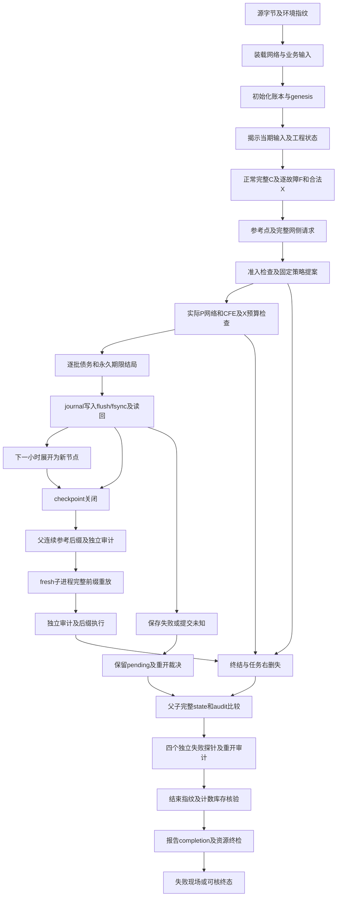

# C：网络范围、完整DAG与结构调用预算

2026-10-22，`DRAFT_NONAUTHORITATIVE`。接续[C交付计划](staged_deliverability_c_scope_and_budget_plan_v1.md)与[B3交接](continuation_handoff_20261022_b3.md)。本次完成范围设计、结构计数及一次保存记录只读核验；主实验整体性能审查仍OPEN。根代理为唯一writer，两个子任务仅只读提取。适用`agent.md`第7–9节。

## 1 范围决定与出口

暂按保留公共网络方向设计：**唯一主网络候选为PYPOWER所带IEEE RTS-24，单接入点，声明事故集的持续状态DC评价；两母线保留为机制回归。** 这是后继开发的设计选择，尚未进入当前B3执行图。用户若选择将主比较收缩为两母线，按该范围重审；本次保存证据核验不依赖此选择。

RTS-24入口为[src/grid/rts24.py](../../src/grid/rts24.py)，24母线、33机组、38支路的既有检查在[网络测试](../../tests/test_rts24_dc_opf.py)。采用现有[minimum_curtailment接口](../../src/grid/network_grid_need.py)作为待接路线；它按基准DC-OPF和选定持续故障计算完整请求。RTS-GMLC依赖更重的逐时源、正常运行与认证链，当前不作为最小后继。

未来D/E的直接输出限定为：在具名静态DC benchmark、声明的阶段/事件/业务路径和固定策略下，比较给定计划的条件判断、任务恢复、期限及清洁匹配。输出继续分四层：实际轨迹、完整F/X网络条件、一小时业务必要条件、完整F/X时序背书。最后一层需要独立的反事实任务/事件时序定义；当前业务必要条件失败及`aggregate_contract_release=false`保留。

**在后继模型写入前必须固定的输入表**：POI、候选工程及投运路径、背景负荷、正常/故障集合、F/X额度、设备—业务—取电缩放、D及策略、清洁路径、前史/登记/后续观察、故障与恢复时序。旧RTS-24配置的bus8、37支路+32机组事故及合成redispatch仅作复用候选，不能自动继承为本论文合同；约1MW的B小例也不能直接拼接旧50–250MW方案。未选定项是明确前置缺口，主实验调用总数与wall预算保持未知。

本轮不变更论文主张或冻结候选状态。DC范围、现实参数来源不足、selected故障及固定策略失败的解释遵守现有[最小规格](../model_spec/staged_deliverability_minimum_spec_v1.md)与[blocker](../model_spec/blocker_register.md)。完整时序合同背书和网络推广分别推进。

## 2 当前实现与目标DAG

当前[B3 runner](../../experiments/staged_termination_b3_development_v1.py)的实际依赖如下；括号表示目标后继待接的步骤。



D至J按小时展开成各自的新节点；每个reopen也展开成独立的前缀调用和审计节点，不形成循环复用或折扣。完整路径还包含导入/解释器启动、selected依赖重复校验、外部publish故障hook、child轮询/心跳、最后事件、SHA库存、completion rename/读回、子进程退出检查及失败时的child停止。同步I/O可能阻塞，failure报告本身仅best effort；这些边界不能由成功completion推为已解决。

目标D/E在D之前增加`给定计划×外生路径×资源点×评价方法`调度；E在选择结束后冻结建设计划/容量/策略，揭示独立留出输入。每种方法先产生自己的连续状态与请求，简化安排再在完整约束上回放。留出路径不参与选择。

现有缺口已由源码核实：

- B1有三种标量评价；[B2 initialize_network](../../src/staged_network_development_v1.py)第268行附近固定`full_temporal`。网络耦合三种评价与其物理回放尚未实现，不能直接乘3作为现成runtime。
- [B3 header](../../src/staged_termination_development_v1.py)第124行附近将总跨度限制在10小时内；更长窗口必须使用新successor。
- 两母线解析容量、独立Fraction审计和单源调度不支持一般网状网络。公共网络需要新adapter及独立节点/支路/故障/限额/未决审计。
- 没有当前阶段容量点扫描器；B1/B3只有固定CASES。D/E点数在代表测量及完整预算后确定。

## 3 当前精确计数与增长

令每个网络尝试v有k_v个声明故障。已完成合同检查时，计算角色为`1正常C + 2k_v故障F/post-call + 1 reference + I(actual点完成)`。当前k=2，完整小时7点；提案前拒绝6点；actual数值注入也只完成6点，但已访问业务提案。正常scenario的post-call复用已算normal，不能再计第8点。真实故障与安全枚举分开。

| 路径 | 点计算 | 业务步 | 网络尝试 | 点审计访问 |
|---|---:|---:|---:|---:|
| 三例父参考与fresh child | 362 | 50 | 52 | 446 |
| 缺输入及重开 | 56 | 8 | 8 | 56 |
| 数值未决及重开 | 48 | 7 | 7 | 54 |
| 发布前失败及重开 | 63 | 9 | 9 | 91 |
| 发布后读回失败及重开 | 70 | 10 | 10 | 98 |
| 合计 | **599** | **84** | **86** | **745** |

来源为[B3合同](staged_deliverability_b3_development_contract_v1.md)与[保存report](../../results/tables/staged_deliverability_b3_v1_non_authoritative/attempt_01/report.json)。三例父/child各尝试10、10、6小时，最后一例仅接受5小时；独立审计访问为`2×终态长度+重开前缀4`，故64网络小时、62接受业务小时及446点。四探针分别为`4+4`、`3+失败1+3`、`4+候选1+4`、`4+候选1+5`。合计86尝试中83次完成actual，`6×86+83=599`。数值故障前函数未调用实际PYPOWER，599不包含该失败函数尝试。

完整计数另有17顶层audit、19 network audit、107网络audit小时、103接受业务audit小时、8额外失败提案业务访问、59 journal publish（57返回、2注入异常）、59 fsync及58 journal rename；completion另一次rename。三child顺序执行，四探针是same-process reopen。以上均含重复重放，不是独立样本数。

对任意**同形成功路径的结构算术**，M条轨迹、每条T小时及重开长度L_j：

```text
network_hour_visits = M × (T + Σ L_j)
point_compute_roles = M × (3 + 2k) × (T + Σ L_j)
direct_state_record_visits(initial commits) = M × T²
direct_state_record_visits(reopen after-digests) = M × Σ L_j(L_j+1)/2
```

checkpoint另加其前缀长度；拒绝前的writable检查、候选、失败审计及重放分别加入实际DAG。已有k条时commit的before/after摘要共访问`k+(k+1)`条历史。B3实测391个直接state记录访问可解析分为主路径272，加四探针26、18、35、40。334次writer编码/4,035,550B仅是已计量范围，nested state和独立audit编码未全计。

| 单条成功路径，完整重开一次 | 网络小时访问 | 两母线点角色 | 初次commit直接state记录访问 | 重开after摘要访问 |
|---|---:|---:|---:|---:|
| T=10 | 20 | 140 | 100 | 55 |
| T=24（仅结构算术） | 48 | 336 | 576 | 300 |
| T=192（仅结构算术） | 384 | 2688 | 36864 | 18528 |

24/192行不是已支持执行、资源准入或ETA。T增长还增加每次writable的目录扫描、head/genesis读取及完整record/state编码；每步cohort的拷贝、索引、排序、期限扫描和守恒检查按历史增长，恢复完的cohort仍保留。完整cohort访问尚无实测计数，84/103/391均不能替代。独立业务audit也扫描累积balance。B1离线oracle另有`2^n−1`个Hall子集及O(nT)流网络，硬限12个调用/256观察；B2/B3未调用它，本次不把它并入完整时序策略成本。

公共网络的solver query另计：现有`derive_network_grid_need`每query先1个base DC-OPF，再每个selected状态1个corrective solve，结构上`1+S`调用；旧69状态为70调用/query，仅说明旧接口。SCOPF则把多状态放入一个更大模型，状态数不等于solver调用数。必须逐一确定C/reference/actual角色映射、失败短路及合法复用，**不能用599×70预算新图**。

## 4 成本复用与优化决定

| 项 | 可复用依据 | 当前判定/缺口 |
|---|---|---|
| B1三方法/期限与守恒 | 原九pin、原标量fixture和保存轨迹 | 复用机制语义证据；不作为公共网络整链成本 |
| B2两母线数值/父子重放 | 32仓库pin、7选定外部、同环境、同形记录 | 362点与12.327s仅为该组件保存观测 |
| B3终结/journal/重开 | 42仓库pin、7选定外部及同Python/包版本 | 599点/15.321s脚本、15.639s解释器启动至退出、采样RSS270778368B、机器工件2229793B；只覆盖10小时两母线 |
| 逐阶段wall | 父等待child与child阶段重叠 | 父fresh wait9.079s，指纹合计1.896s；不相加嵌套计时或按每点外推 |
| 公共网络/三方法/更长时域 | 尚无相同实现/输入/环境/形状测量 | wall、RSS、bytes未知；主实验预算OPEN |
| 昂贵真实失败与清理 | 现有注入是实际write/flush/fsync后声明异常 | 真实阻塞I/O、kill、坏盘/掉电及报告失败未测 |

合法复用需完全相同的源字节、工程网络状态、POI、背景负荷、P角色/值、事故集、dispatch/carry、策略、solver和环境；仅共享清洁总量或小时索引不足以复用。当前C不改B3缓存或校验合同。

优化优先顺序：保留已实现正常C别名复用及父参考前缀复用；公共网络后继先列exact-key DAG，再审查相同合同查询的复用；fresh重开和独立审计保留实际成本。跨历史缓存actual/request不采纳，因dispatch/carry freshness未证明；全规模前缀重复重放不扩大，因O(T²)编码和cohort成本未闭合；并行不用于抵消未知预算，先串行测一包。

## 5 本次只读验证合同

入口[staged_c_saved_cost_audit_v1.py](../../experiments/staged_c_saved_cost_audit_v1.py)，固定输出`results/tables/staged_deliverability_c_v1_non_authoritative/saved_audit_01`，独占创建，一次保存核验，无重试/覆盖。它只读取B1–B3三个attempt的全部文件、源pins及选定依赖，不导入模拟器、潮流或solver；不重放物理状态。普通针对测试在system/pytest tmp执行，与本次保存核验分开。

执行DAG为`创建新输出→绑定本页/工具/测试→B1–B3全树size/SHA前快照→源/选定外部/环境检查→B2/B3 completion库存核验→读取父子state及pending重算点角色/提案/网络尝试→原runner AST计数与保存report对账→全树/源/外部后快照→报告/终检`。另只读本机PYPOWER所带case24源，AST核对24/33/38数组行数并作SHA前后检查，不执行case、不构建模型。正常点别名只计一次；拒绝candidate用于工作量，仍不加入已接受state。四probe逐一核对终结/重开原因及state关系：前三例只恢复原已接受前缀，发布后读回失败则恰好采用保存的candidate且只增加一条记录。599/84/86独立从角色重算；745等计数仅核对原登记与保存值，不冒称本次重新测量。

规模/上限：仅三个旧attempt，输入≤250文件/32MiB、单文件≤8MiB；一次新保存核验、0新flow/solver/child。固定wall60s、当前进程RSS512MiB、每份输出≤4MiB，串行；文件间检查wall/RSS与数量/bytes，超限保留failure并退出，不顺延。它是短时只读机械核验，非OS硬配额；同步读取/报告写入可能阻塞，failure报告best effort。最终stdout给终态，启动至退出outer另由调用者保存。字节bookends不证明锁保护或同值ABA，selected依赖也不是生产完整环境闭包。

## 6 后继缺口与有限预算门槛

1. 按第1节完成RTS-24输入表；新adapter/配置/网络独立audit与三评价回放单独版本化，保留B1–B3源/记录。正常完整C、故障F及合法X、实际点、服务缺口继续分层。RTS-24跨小时发电ramp、UC及故障响应时标不由静态case推定。
2. 构建后先做无solver schema/规模/DAG与残差oracle小例。准备代表包时再固定同一网络上1个阶段、1小时、明确selected集合、query/solver调用上限与一次重开；完整网络输入及公共网络失败/报告路径都需覆盖。更长时域、cohort增长、三评价以及失败收尾需要独立代表性证据，不由单小时关闭C。
3. **本次未登记可直接启动的native探针。** 新真实solver/native测量必须先登记具体实现/输入/次数/call cap、wall/RAM/存储、心跳/无进展/安全停止及验收问题，按规则取得具体授权；当前不能以未来设计常数冒充有依据的wall预算。
4. 完成代表性实测、身份绑定和失败路径预算后，才固定D的计划×路径×D点×三方法及E留出数和总资源。现在各乘数及总wall仍OPEN。所有formal/resource/H1及完整时序合同门禁按原定义保持。

保存核验完成后的报告入口：[C保存审计说明](../../results/tables/staged_deliverability_c_v1_non_authoritative/saved_audit_01/validation_report.md)。本页是该次核验的输入，运行后不倒写本页；后续状态更新进入执行步骤/blocker及C交接。
