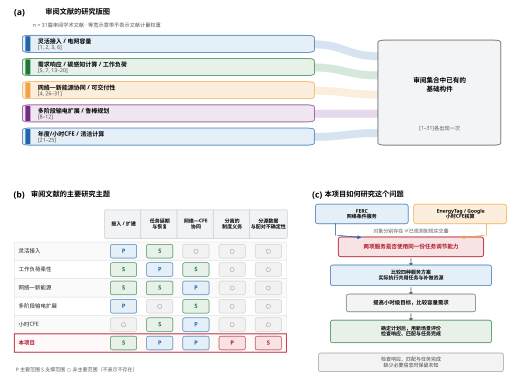
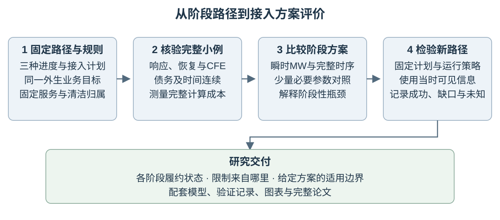

# 达产与扩建延期不确定性下智算中心分阶段接入与小时级绿电协同规划

更新日期：2026-10-17。本文介绍当前研究设计及已有证据；实验进度以第5节的日期快照为准。

## 1 摘要

网络条件服务与小时级无碳电力（carbon-free energy, CFE）匹配可能同时调用数据中心可延期、可恢复的计算任务。本项目研究：当网络安全调用为硬约束时，提高小时级CFE目标如何改变最低业务柔性需求，联合时序会形成额外需求还是组合缓解，以及分离记账会产生何种容量偏差。首篇论文聚焦这一RQ2问题；多阶段F/X接入、扩建延期和年度/小时CFE对规划决策的影响构成后续扩展。

当前获批开发的finite-v2合同评价168小时登记期内全部适用服务请求及所产生延期工作的按期履约，并在仍需判断登记结果时最多延续24小时，总模拟跨度最长192小时。各独立episode从显式机制初态开始；窗口内连续保留业务债务、事件预算及电网状态。削减功率q与恢复功率r共同满足q+r≤D，恢复还受业务headroom、期限和适用的同小时CFE-compatible surplus约束。后续新请求仍占用物理资源，但不扩展登记评分集；缺少必要的后续输入时保留unresolved或右删失。

研究比较network-only、CFE-only、joint-correct与joint-B6四臂，目标是完整训练支持上、由同一因果业务策略履约所需的最低归一化双向容量。四臂对象记为\(D_N,D_C,D_B,D_J\)，并沿用有符号分解
\(I_{joint}=D_J-\max(D_N,D_C)=I_{sep}+A_{B6}\)，其中
\(I_{sep}=D_B-\max(D_N,D_C)\)，\(A_{B6}=D_J-D_B\)。B6的两份规划账分别占用同一份可用量与容量，固定策略的实际执行则进入一份共享物理包络。容量证据以同一完整合同下的有效下界和完整履约上界组织；未取得有限证书时保留未知，不预设四臂顺序或差值符号。

当前设计含19组业务合同参数及1%至100%、步长1个百分点的CFE目标，共1,900个参数单元。它是观察旧设计诊断结果之后形成的探索性后继，科学参数已获批开发，具体执行包仍为DRAFT_NONAUTHORITATIVE。现有成果包含合成规划机制、公开selected-N-1 DC benchmark和多项开发验证；完整连续四臂实验、容量前沿及正式holdout结果尚未发布。

**关键词：**智算中心；小时级CFE；联合服务；有限登记合同；双向柔性容量；恢复债务；因果策略

## 2 研究现状

### 2.1 两类制度对象及 contract-overlap hypothesis

FERC 195 FERC ¶ 61,216 及其引用的 PJM precedent 表明，愿意且能够限制 withdrawal 的大型负荷可以按指定 MW contract level 接受网络侧服务，并由控制或保护措施执行取电边界。EnergyTag Granular Certificate Matching Standard 与 Google 24/7 CFE 方法支持按同一时间间隔、规定地域和计量边界开展小时级 CFE 的 ex-post accounting/matching。两条证据链分别支撑 network-contingent service arrangement 与 hourly-CFE accounting/matching；共同合同、计量和内部工作负荷映射仍需直接证据。因此，本文把两类义务对同一 temporal workload envelope 的潜在交叠登记为可证伪的 contract-overlap hypothesis。

### 2.2 灵活接入与电网容量规划

数据中心接入研究已覆盖候选站址、容量分配和互联扩展。Kim、Dong和Xie[1]把 firm、pause 与 shift 包络纳入规划者主动选址和逐时单故障筛选，说明柔性可改变候选接入点评价；Chen和Zheng[2]在投资—逐时运行模型中比较工作延期、时移和跨节点转移对互联容量扩展的影响。Li、Fang和Chen[3]将 robust firm capacity、CVaR flexible capacity 与位置属性用于静态输电容量分配，Mytton等[6]则从电网容量压力和治理流程说明大型数据中心接入的现实约束。这些工作建立了 flexible interconnection 和 grid-capacity planning 的直接基础。本文首篇聚焦分离制度义务的共同业务资源；固定POI下的多阶段F/X释放、扩建工期与延期保留为项目扩展。

### 2.3 需求响应、碳感知计算与工作负荷包络

Wierman等[13]系统梳理了数据中心需求响应的技术机会与运营约束，Liu等[14]研究了公用事业峰值需求响应中的工作负荷调节和成本。Goiri等的 GreenSlot[15]以及 Parasol and GreenSwitch[16]分别以批作业调度和系统协同利用现场可再生能源；Qureshi等[17]通过跨地域路由利用电价差，Liu等[18]通过 geographical load balancing 跟随可再生能源供给。Radovanović等[19]进一步用区域碳强度形成逐时 virtual capacity curve，建立了实际数据中心的 carbon-aware computing 路径。

资源约束方面，Kwag和Kim[20]说明需求响应需要超越单一静态MW上限；Crozier和Liska[7]综述了保护、预冷、CPU/GPU调节和作业调度等柔性来源；Williams等[5]以GPU集群和推理业务实证分析快速响应与持续削减。上述研究支撑工作负荷可调性及功率、持续时间和恢复参数的技术边界。本文把这些既有机制组织进有限登记期及其按需后续观察的共享时序包络，显式连接跨日恢复债务、事件状态和双向功率容量，并以B6反事实检验分离规划的后果。

### 2.4 统一调度下的网络—新能源协同与可交付性

Wan和Li[4]把数据中心时空负荷灵活性纳入 security-constrained unit commitment，在统一调度变量下缓解拥塞并促进新能源利用。Wan、Fang和Li[26]的 arXiv:2511.08759 于2025年发布v1、2026年更新v2，以单一空间重分配变量分析拥塞、弃电与成本；Ma等[27]用内生节点价格驱动时空移峰；Lin和Chien[28]研究多站点 load decoupling 资源的碳收益分配；Zhang等[29]则刻画输电约束如何降低柔性资源的可用性。这些工作正面建立了统一物理调度下的网络—新能源协同基准。

Fan和Zhao[30]联合优化 workload distribution 与 regulation capacity commitment，并以 chance constraints 和 queue-VaR constraints 约束 instantaneous/cumulative deliverability。Khanal等[31]在PJM和韩国容量扩展中建模 firm/flexible/interruptible tiers，以及 depth、duration、ramp、minimum recovery、年度能量和小时上限。因此，capacity commitment、deliverability、event shape 和 recovery 已有明确优先权。本文聚焦固定网络安全调用下、随小时级CFE目标变化的完整时序可交付前沿，并用四臂有符号分解区分单服务瓶颈、联合交互和B6容量偏差。

### 2.5 多阶段输电扩展与鲁棒规划

Han、Kim和Lee[8]用场景树研究需求不确定性下的长期多阶段输电扩展；Webster[9]提出广域多阶段随机输电扩展算法；Akhavizadegan、Wang和McCalley[10]研究迭代随机扩展中的场景选择。Jabr[11]处理新能源与负荷不确定性下的鲁棒输电扩展，Li等[12]进一步把多重不确定性和主动负荷纳入规划。这些研究为场景树、非预见性、鲁棒性和扩建决策提供方法基础。项目后续扩展将这些方法用于固定POI的数据中心达产、F/X释放和工程延期，但不把多阶段规划或鲁棒优化本身作为首篇贡献。

### 2.6 年度匹配、小时级CFE与清洁计算

de Chalendar和Benson[21]指出年度100%可再生能源声明不能完整反映用电时段与系统脱碳；Miller、Novan和Jenn[22]量化了小时核算与年度/月度聚合之间的差异。Riepin和Brown[23]比较年度与24/7 CFE采购的成本和系统影响，Riepin、Jenkins、Swezey和Brown[24]分析24/7匹配对先进清洁技术部署的影响。Riepin、Brown和Zavala[25]进一步联合优化计算负荷的时空转移，以提高计算活动与清洁电力在时间和空间上的一致性。这些工作构成年度/小时核算、采购与清洁计算调度的直接基准。本文在此基础上研究分离的网络条件义务与小时CFE义务是否索取同一业务包络。

### 2.7 联合可交付前沿、归因与稳健性

本文把研究对象定义为固定网络安全调用下、随小时级CFE目标变化的业务柔性需求前沿。四臂设计先识别network-only和CFE-only中更严格的单服务，再计算joint-correct相对单服务的有符号联合交互，并用joint-B6分解其容量偏差。RTS-GMLC与Alibaba保持各自来源、时钟和train/holdout划分；它们的组合属于声明的机制benchmark coupling。既有transport工具可支持配对稳健性分析，新连续合同仍须明确风险事件、窗口权重和删失口径；只有这些输入就绪后，才能计算相对于声明transport polytope的条件sharp bounds。多指标结论要求同一个coupling见证。阴性结果、外生电网不可行（E0）、服务短缺和unresolved分别保留。

**图1 当前研究现状与本项目定位**。基于本文审阅的31篇学术文献所作的结构化定位，不是穷尽性 bibliometric result；三项制度资料仅支撑两类对象分别存在，不证明现实 contract overlap。

## 3 首篇拟形成的贡献与项目扩展

### 3.1 联合业务柔性的有限登记可交付前沿

首篇研究在固定共同reference规则、网络安全调用和完整时序包络下，刻画CFE目标变化对应的最低双向柔性容量。主factorial由三档可延期比例与三档恢复headroom组成，另有10组时序参数OAT合同，共19组业务合同；各合同使用同一组100个CFE目标。完整训练支持是科学量词，具体计算可使用有证明引用的整cell解析排除及合法任务复用。

每臂的容量对象要求该参数单元内存在同一个因果业务策略，对全部声明训练支持履约。有效下界须来自同一完整合同的合法松弛；可行上界须有具名固定策略在完整支持上的履约见证，并按适用范围通过actual电网验收。B6上界只认证其分账规划对象，共享实际执行另行评估。固定策略失败只说明该策略和容量未获成功见证，不能推出所有策略均不可行。

### 3.2 四臂有符号归因与固定策略后果

四臂分解区分更严格的单服务瓶颈、联合时序交互和B6分账容量偏差。只有各臂容量证据足以支持时，才报告差值或其区间与符号。联合correct模型是两项独立服务承诺相加的机制benchmark：共同请求为g+c；B6分别检查两条规划账，而actual执行仍只有一份可延期量、D、债务和事件预算。该对象不代表所有物理共服务策略中的最低资源。

holdout执行前冻结有完整训练可行证据的容量与具名策略，逐小时只使用已揭示输入。业务动作和Actual电网状态成对提交，分别记录hard-grid、CFE及联合履约结果；源数据缺失、未覆盖恢复期限和求解未决保持显式unknown。公开边缘transport与共同coupling witness作为后续稳健性工具，其风险定义与接口须适配连续合同。

### 3.3 设计版本与长期项目扩展

旧版36-cell主factorial与10-cell时序OAT共46个参数单元的确认性设计，以及更早70-cell诊断，保留各自冻结合同与结果身份。当前1,900-cell finite-v2是看过旧诊断后的探索性后继，其映射、时序合同和reference已经改变；后续新计算按新合同报告。

长期项目研究固定POI下，数据中心达产和工程进度逐步揭示时的非预见性多阶段F/X释放、扩建启动与投运时序，并比较年度和小时级CFE对容量、建设和柔性分配的影响。F表示约定安全范围内的保供容量，X表示可按合同条件调用的容量。已有B0至B5规划与固定策略执行基础支持这一后续扩展。

## 4 研究目标与主要内容

### 4.1 主目标与合同参数

主目标是完整有限登记合同下的因果最低双向容量及其可审计界。登记期E=168h，起点stride=24h，登记工作的统一期限为birth+24h，最大follow-up为24h；登记期和实际后续共用一个最长192h的nonrolling账期，跨日不重置预算。初态、可延期比例、恢复效率和headroom均为注册机制假设。

主factorial采用f∈{0.05,0.20,0.50}和ρ∈{0,0.10,0.30}，另以恢复效率、最大持续时间、事件数、能量预算和债务上限构成10组OAT合同。功率按假设D_DC=250MW归一化，D∈[0,1]；250MW是模拟尺度，原始工作负荷超过映射域时保留原值并标记mapping unresolved。

### 4.2 因果电网与业务执行链

H1表示每步使用当前小时已揭示输入的网侧机制。状态分为共同正常链N、共同reference链Rref及各臂Actual链A。正常链不把当期事故吸收进正常基准；reference在当前正常组合及已揭示事故/修复条件下产生共同网侧请求，其选择不读取CFE目标、业务参数、D或各臂响应后的状态。Actual链承接各臂业务动作后的固定功率。三类状态保持各自carry。

每小时按“揭示输入→更新N→Rref发布共同请求→CFE映射→因果业务动作→Actual验收→成对提交”推进。实际削减产生一份恢复债务；未服务请求单列shortfall。恢复按已知due及birth顺序分配，并检查容量、headroom和适用清洁余量。登记后的新工作保留在物理账中，评分集保持为登记期cohort。

### 4.3 计算设计与评价流程

1. 保留分源、同chain/seed/split内的连续窗口及完整支持清单；
2. 对19组业务合同与100个CFE目标组织四臂容量下界、具名策略上界和解析排除证据；
3. 对复用任务核对完整输入与初态身份，不能仅按相同source hour合并；
4. 在holdout前冻结训练端容量与策略，保存成功、失败、未决及恢复期限覆盖情况；
5. 在风险事件、窗口权重与coupling集合注册后，评估配对稳健性和共同coupling见证；
6. 验收原始报告、残差、gap、状态延续、成对提交及关闭重开后的独立重放。

支持清单当前包含每cell 523×28=14,644个training pair及512×28=14,336个holdout pair；这些是机制组合身份，重叠窗口不作为独立样本。1,900个cell对应27,823,600个training cell-pair身份，实际solver调用量取决于解析排除和合法复用DAG，须由具体任务包和完整预算确定。

**图2 有限登记联合服务的研究流程。**展示当前设计中的数据、四臂模型与评价依赖；实现验收进度见第5节。

**图3 智算中心与电网协同网络结构。**固定POI与共享业务柔性构成首篇机制基础；图中的分阶段达产及电网扩建属于长期项目蓝图。

## 5 项目可行性与当前状态

### 5.1 已有模型与具名benchmark

项目已实现RTS-24 DC-OPF与联合安全校核、确定性扩建、F/X服务平衡、B0至B5基线、非预见性与固定策略合成holdout，以及持续时间、事件数、能量和恢复债务包络。冻结确定性实例的接入缺口为B0=327,600MWh、B1=B2=109,200MWh；合成随机树中B4相对B3改善128,800MWh，holdout也保留了部分路径劣化。上述结果支持各自机制范围，正式经验VMA仍未发布。

RTS-GMLC已有6小时和完整24小时selected-N-1 DC SCUC/固定组合ED，以及六候选POI比较。24小时benchmark每小时复核12个注册状态，其结果文件和manifest已发布。直接AC复核及零数据中心恢复诊断尚未取得完整官方边界内可行见证，h15/h21仍未解除；security_certified保持false。

### 5.2 公开数据与机制身份

RTS-GMLC网侧、Alibaba业务及Google功率资料均保留各自来源、版本与时钟。公开边际可支持声明的机制窗口与coupling；绝对业务MW、真实可恢复比例、deadline、恢复headroom和同钟事故证据仍不足。250MW与业务参数继续标记为mechanism_assumption，不能拼接为观测联合分布或经验履约概率。

获批origin/registry后继已覆盖旧事故源的六个左边界缺口，保存检查记录为1,035个unique entries、source_input_unresolved=0且obligations_removed=0。这项来源覆盖不等于完整192h producer执行已验收。末端状态、按需follow-up和未知结局仍须由连续链实际证明。

### 5.3 2026-10-17开发进度快照

finite-v2科学参数于2026-09-30获批开发；具体配置仍为DRAFT_NONAUTHORITATIVE，complete_preregistration、formal_execution_ready和formal_run_authority均为false。normal模型、来源适配、持久状态、选择器、原始报告保留及限定范围PRE_SEAL已有开发证据。

截至2026-10-17 14:38（Asia/Shanghai）核查，正在运行的chain_07是首个模拟小时的合成集成验收。保存trace已到达三个独立N0、common、共同Rref、三个Actual和逐项缺Actual拒绝检查；完整成对提交、关闭重开、独立保存记录重放及报告尚无整链成功终态。它使用模拟求解器输出验证实际执行的来源读取与状态组合路径，输入及来源替换点保持合成测试身份，不能作为新合同的正式容量或风险结果。

当前主要计算瓶颈是完整校验路径中的重复历史重建与I/O。局部优化已有科学输出及audit等价证据，整体收益和预算仍须完整路径实测。2026-10-17新增的启动条件要求任何新实验先审查任务DAG、真实调用倍数、可复用证据、分阶段时间/内存/存储、心跳与停止条件；合成和native耗时分别登记。192h描述模拟跨度，实际墙钟预算尚未核定。

### 5.4 进入正式实验前的出口

| 顺序 | 必须完成的对象 | 当前状态 |
|---|---|---|
| 1 | 完整hour-0及独立保存重放、清理和计时 | 验证中 |
| 2 | 跨小时及最长192h的producer/phase覆盖 | 未完成 |
| 3 | 具体任务/复用DAG、同合同LB/UB与资源准入 | 未完成 |
| 4 | successor封存及全新独立official review | 尚未完成本轮执行包审查 |
| 5 | 对具体包单独取得运行授权并验收正式结果 | 尚未启动 |

旧70-cell诊断和V8非正式two-block pilot保留各自历史证据。早期grid正式attempt只形成9/1,071个历史checkpoint，完整grid package未发布。当前连续合同的容量前沿和holdout正式结果均未发布。

## 6 预期成果与研究边界

### 6.1 预期成果

1. 有限登记完整履约对象的四臂容量前沿、有效LB/UB及未决区域；
2. 由容量证据支持的I_joint=I_sep+A_B6有符号分解；
3. 具名训练容量和固定因果策略的holdout网络、CFE及联合履约后果；
4. 连接业务债务、事故状态与电网carry的原始报告、成对提交和独立重放证据；
5. 适用时的coupling稳健性，以及多阶段F/X、扩建与年度/小时CFE后续扩展。

### 6.2 研究边界

主要estimands为按D_DC归一化的业务双向容量及其有符号交互；解释为条件接入容量X还需显式、可验证的映射。联合相加承诺、参考调度和恢复策略均具有具名机制身份。有限登记工作的按期履约只属于该有限合同，不能外推为无限期可持续服务。

holdout权重与transport区间相对于声明的benchmark支持与coupling集合成立；经验总体概率、真实合同发生率和因果效应需要额外证据。selected-N-1 DC结果属于具名计算范围，工程安全还依赖完整安全集合、AC、设备和控制参数。CFE表示同小时、规定地域内可归属清洁电量的核算匹配。

timeout、局部求解失败、缺少incumbent或不完整证书保留为相应未决状态。缺少必要follow-up时诚实报告未知或删失；已经观察到的违规仍保留。只有完整证据支持时，才形成容量区间、差值符号和服务结论。

## 7 参考文献

[1] Kim, D., Dong, L. and Xie, L. (2026). “Flexibility-aware framework for efficient planner-initiated siting of data center.” Nature Communications. https://doi.org/10.1038/s41467-026-72324-9

[2] Chen, Y. and Zheng, X. (2026). “To Defer or To Shift? The Role of AI Data Center Flexibility on Grid Interconnection.” ACM Sustainability Week. https://doi.org/10.1145/3765611.3815593; https://arxiv.org/abs/2604.05376

[3] Li, S., Fang, B. and Chen, C. (2026). “Risk-Aware Allocation of Transmission Capacity for AI Data Centers.” arXiv preprint arXiv:2604.08854. https://arxiv.org/abs/2604.08854

[4] Wan, H. and Li, X. (2026). “Data Center Spatio-Temporal Load Flexibility in Security-Constrained Unit Commitment for Enhanced Grid Efficiency and Reliability.” arXiv preprint arXiv:2605.18517. https://arxiv.org/abs/2605.18517

[5] Williams, C., Colangelo, P., Coskun, A. et al. (2026). “Power-Flexible AI Data Centers: A New Paradigm for Grid-Responsive Compute.” arXiv preprint arXiv:2606.25098. https://arxiv.org/abs/2606.25098

[6] Mytton, D., Ashtine, M., Wheeler, S. and Wallom, D. (2023). “Stretched grid? Managing data center energy demand and grid capacity.” Oxford Open Energy. https://doi.org/10.1093/ooenergy/oiad014

[7] Crozier, C. and Liska, M. (2025). “The Potential of Data Center Energy Demand To Provide Grid Flexibility.” Current Sustainable/Renewable Energy Reports. https://doi.org/10.1007/s40518-025-00258-9

[8] Han, S., Kim, H.-J. and Lee, D. (2020). “A Long-Term Evaluation on Transmission Line Expansion Planning with Multistage Stochastic Programming.” Energies. https://doi.org/10.3390/en13081899

[9] Webster, M. (2022). “A Multistage Stochastic Transmission Expansion Algorithm for Wide-Area Planning under Uncertainty.” Technical report. https://doi.org/10.2172/1737833

[10] Akhavizadegan, F., Wang, L. and McCalley, J. (2020). “Scenario Selection for Iterative Stochastic Transmission Expansion Planning.” Energies. https://doi.org/10.3390/en13051203

[11] Jabr, R. A. (2013). “Robust Transmission Network Expansion Planning With Uncertain Renewable Generation and Loads.” IEEE Transactions on Power Systems. https://doi.org/10.1109/TPWRS.2013.2267058

[12] Li, W., Zhao, L., Bo, Y. et al. (2021). “Robust transmission expansion planning model considering multiple uncertainties and active load.” Global Energy Interconnection. https://doi.org/10.1016/j.gloei.2021.11.009

[13] Wierman, A., Liu, Z., Liu, I. and Mohsenian-Rad, H. (2014). “Opportunities and Challenges for Data Center Demand Response.” 2014 International Green Computing Conference, pp. 1–10. https://doi.org/10.1109/IGCC.2014.7039172

[14] Liu, Z., Wierman, A., Chen, Y. et al. (2013). “Data center demand response.” ACM SIGMETRICS. https://doi.org/10.1145/2465529.2465740

[15] Goiri, I., Le, K., Haque, M. E. et al. (2011). “GreenSlot.” SC Conference. https://doi.org/10.1145/2063384.2063411

[16] Goiri, I., Katsak, W., Le, K. et al. (2013). “Parasol and GreenSwitch.” ASPLOS. https://doi.org/10.1145/2451116.2451123

[17] Qureshi, A., Weber, R., Balakrishnan, H. et al. (2009). “Cutting the electric bill for internet-scale systems.” ACM SIGCOMM. https://doi.org/10.1145/1592568.1592584

[18] Liu, Z., Lin, M., Wierman, A. et al. (2011). “Geographical load balancing with renewables.” ACM SIGMETRICS Performance Evaluation Review. https://doi.org/10.1145/2160803.2160862

[19] Radovanović, A., Koningstein, R., Schneider, I. et al. (2023). “Carbon-Aware Computing for Datacenters.” IEEE Transactions on Power Systems. https://doi.org/10.1109/TPWRS.2022.3173250; https://arxiv.org/abs/2106.11750

[20] Kwag, H.-G. and Kim, J.-O. (2012). “Optimal combined scheduling of generation and demand response with demand resource constraints.” Applied Energy. https://doi.org/10.1016/j.apenergy.2011.12.075

[21] de Chalendar, J. A. and Benson, S. M. (2019). “Why 100% Renewable Energy Is Not Enough.” Joule. https://doi.org/10.1016/j.joule.2019.05.002

[22] Miller, G. J., Novan, K. and Jenn, A. (2022). “Hourly accounting of carbon emissions from electricity consumption.” Environmental Research Letters. https://doi.org/10.1088/1748-9326/ac6147

[23] Riepin, I. and Brown, T. (2024). “On the means, costs, and system-level impacts of 24/7 carbon-free energy procurement.” Energy Strategy Reviews. https://doi.org/10.1016/j.esr.2024.101488; https://arxiv.org/abs/2403.07876

[24] Riepin, I., Jenkins, J. D., Swezey, D. and Brown, T. (2025). “24/7 carbon-free electricity matching accelerates adoption of advanced clean energy technologies.” Joule. https://doi.org/10.1016/j.joule.2024.101808

[25] Riepin, I., Brown, T. and Zavala, V. M. (2025). “Spatio-temporal load shifting for truly clean computing.” Advances in Applied Energy, 17, 100202. https://doi.org/10.1016/j.adapen.2024.100202; https://arxiv.org/abs/2405.00036

[26] Wan, H., Fang, L. and Li, X. (2025/2026). “Grid Operational Benefit Analysis of Data Center Spatial Flexibility: Congestion Relief, Renewable Energy Curtailment Reduction, and Cost Saving.” arXiv preprint arXiv:2511.08759, v1 2025-11-11, v2 2026-03-27. https://arxiv.org/abs/2511.08759

[27] Ma, D., Ye, Y., Wu, Y. et al. (2025). “Bi-Level Optimisation Model for Harvesting Spatial-Temporal Load Shifting Flexibility of Data Centres Using Endogenously Formed Locational Price Signal.” IET Smart Grid, 8(1), e70020. https://doi.org/10.1049/stg2.70020

[28] Lin, L. and Chien, A. A. (2025). “Distribution and Management of Datacenter Load Decoupling.” arXiv preprint arXiv:2511.08936. https://arxiv.org/abs/2511.08936

[29] Zhang, W., Fang, L., Zhao, F. et al. (2025). “Operational risk assessment of power system considering transmission limitation on flexible resources and its application to SCUC.” AIP Advances, 15, 115016. https://doi.org/10.1063/5.0302342

[30] Fan, Y. and Zhao, J. (2026). “Harnessing Flexible Spatial and Temporal Data Center Workloads for Grid Regulation Services.” arXiv preprint arXiv:2602.01508. https://arxiv.org/html/2602.01508

[31] Khanal, S., Roh, G., Yao, B. et al. (2026). “Shift or curtail? How much data-center flexibility is worth depends on the host power grid.” arXiv preprint arXiv:2608.19622. https://arxiv.org/html/2608.19622

## 8 制度与标准资料

- Federal Energy Regulatory Commission (2026). 195 FERC ¶ 61,216; Docket EL26-69-000, Order Instituting Proceeding Under Section 206 of the Federal Power Act. https://www.ferc.gov/sites/default/files/2026-06/EL26-69-000.pdf
- EnergyTag (2024). Granular Certificate Matching Standard, Version 1. https://energytag.org/wp-content/uploads/2024/03/Granular-Certificate-Matching-Standard_V1.pdf
- Google (2021). 24/7 Carbon-Free Energy: Methodologies and Metrics. https://sustainability.google/reports/24x7-carbon-free-energy-methodologies-metrics/

## 9 当前设计与进度的仓库依据

- [科研范围与首篇定位](../../agent.md)：RQ2主线、长期三问及证据边界；
- [finite-v2参数合同](../../configs/rq2_finite_mechanism_protocol_candidate_v2.DRAFT.yaml)与[模型规格](../../docs/model_spec/rq2_finite_mechanism_protocol_candidate_v2.md)：168h、24h、q+r≤D、1,900 cells及开发授权；
- [执行计划](../../docs/plan/科研项目执行步骤.md)与[blocker register](../../docs/model_spec/blocker_register.md)：阶段证据、开放问题和解除条件；
- [H1端到端里程碑](../../docs/plan/H1_端到端里程碑验收_v1.md)：完整hour-0至正式运行的验收顺序；
- [chain_07保存计时](../../results/tables/rq2_h1_hour0_end_to_end_v2_non_authoritative/chain_07/timing.jsonl)与[来源边界检查](../../results/tables/rq2_h1_hour0_end_to_end_v2_non_authoritative/source_boundary_status_rechecked_01.json)：开发进度与获批来源覆盖；
- [B0-B2结果](../../results/tables/rts24_b0_b2_summary.json)、[B3-B5结果](../../results/tables/rts24_b3_b5_summary.json)及[24小时DC benchmark](../../results/tables/rts_gmlc_google_day0_full24h_selected_n1_dc_scuc_v1/summary.json)：第5.1节的具名历史证据。
