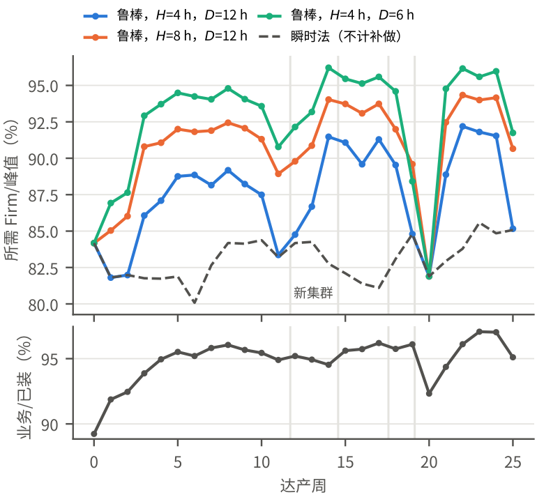
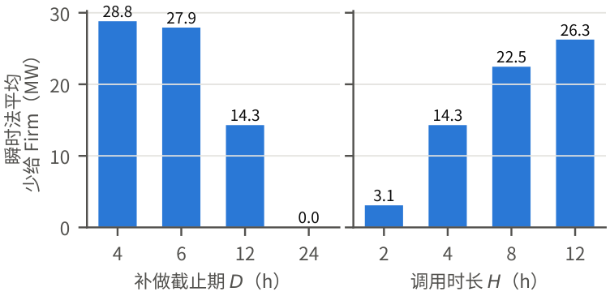

# 计及任务补做期限、随达产状态变化的智算中心分阶段鲁棒接入设计

## 摘要

智算中心的业务增长、计算设备投运与电网扩建通常具有不同的时间进度。柔性接入允许数据中心在电网容量受限时削减用电，但可延期计算任务仍需在截止期内完成，因而同样的削减深度能否兑现，取决于已装设备和后续供电的恢复余量。本文研究随达产状态变化的Firm接入容量与储能配置，以及给定电网下的可接入规模。模型将合同调用或电网N-1故障表示为不确定事件，通过受期限约束的逐小时延期与补做响应，建立两阶段自适应鲁棒设计，并采用列与约束生成和精确枚举对手求解。满足clean-reset条件时，单次响应可用于构造多次调用的非预见策略；调用密集情形需要多阶段处理。基于生产集群轨迹重建负荷和RTS-24网络的初步可行性研究表明，补做约束的影响与缺口持续时间、补做截止期及达产状态有关。在已测合同调用网格中，截止期放宽至24小时后设计差异消失。研究据此聚焦于识别补做感知设计的必要条件及瞬时评估的适用范围。

**关键词：** 智算中心；分阶段接入；Firm容量；自适应鲁棒优化；任务延期与补做；非预见性

## 1 引言

人工智能应用的发展推动了数据中心电力需求增长，也加大了局部电网的接入压力[1,2]。智算中心通常经历持续的达产过程：业务逐步增长，GPU等设备分批安装，而变电站和线路按照独立工期建设。当计算设备和业务先于电网扩建到位时，柔性接入可以通过约定条件下的进口功率调整，为提前接入提供空间[3]。这一安排同时提出一个运行问题：削减的计算工作，能否利用剩余资源在业务期限前补做完成？

对于可延期任务，当前减载能力和后续恢复能力共同决定接入承诺能否兑现。业务利用率较低时，已装设备可能留有较多补做余量；随着业务填满设备，恢复空间会收缩；新设备投运又可能增加余量。因此，即使合同削减深度不变，其对应的Firm容量需求也可能随达产状态变化。接入设计需要把调用期间的响应与期限内的任务完成联系起来。

### 1.1 相关研究

数据中心需求响应研究已表明，任务延期、负荷转移和本地能源资源能够调节电网取电[4,5]。GreenSlot将任务截止时间纳入计算调度[6]。近期研究进一步考察任务补做、事件约束和本地资源对数据中心柔性价值及最小接入容量的影响[7,8]。这些工作为描述“当期延期—后续补做”的时间耦合提供了基础，也说明任务完成条件应进入容量评估。

电网侧的柔性容量研究关注如何在网络约束与服务质量要求下分配Firm和flexible容量。Li等提出分层柔性产品，以允许削减深度δ和超过该深度的概率上限ε描述服务质量，通过聚合改写和CVaR近似求解容量配置[9]。其模型包含发电机跨期爬坡与全规划期概率事件；对允许深度以内的削减，频次不受限制。该工作未显式描述削减后的任务积压、补做截止期与数据中心达产状态。由此产生一个直接比较问题：对于给定δ/ε产品，某一达产阶段的设备与任务条件能够兑现多大的削减深度？比较时还需区分概率服务保证与指定事件集合上的鲁棒保证。

现有研究已经覆盖任务调度和柔性接入的多个组成部分。本文关注的具体联系是，将达产过程中变化的已装设备余量与期限内补做约束共同纳入接入设计，并检验这种联系是否改变容量决策。其价值需要同时由出现差异和没有差异的结果界定。

### 1.2 研究问题与切入点

本文考察单一接入点的数据中心。在每个达产阶段，业务需求、已装计算能力与电网供电边界分别给定。第一阶段决定Firm容量和可选储能，第二阶段根据已获知的调用逐小时安排延期、补做和充放电。对于给定电网，也可固定单位规模的数据中心形状，反求能够接纳的最大规模。

核心问题是缺口的持续时间与深度，是否超过任务在截止期前可利用的设备和供电余量。短时尖峰可能由少量延期消化，持续缺口则可能积累较多待补做工作。然而，可延期工作何时到达、恢复余量何时可用、截止期何时到来，以及运行能够知道哪些事件，都会影响结果。本文以这些时序约束为依据，研究何时必须采用补做感知设计，何时瞬时评估已经足够。

### 1.3 本文工作与预期贡献

本文建立随达产状态变化的鲁棒接入设计，将已装GPU容量、业务负荷、可延期比例与任务恢复期限联系起来。在同一框架中，分别研究满足合同调用所需的Firm容量及储能，以及满足声明N-1条件时电网可接纳的数据中心规模。阶段间资源差异由给定路径描述，当前实现对各阶段独立求解并比较。

求解采用列与约束生成（C&CG）[10]。对于有限的单次调用集合，主问题给出容量与名义运行安排，对手逐一检查允许的调用位置，并加入最不利事件。多次调用通过有条件的clean-reset可拆分性处理：当每次响应均能在下一次通知到来前清空积压并恢复名义状态时，单次响应可拼接为非预见策略。调用之间的恢复过程相互重叠时，需进一步处理多阶段信息结构。

初步研究已覆盖合同调用、储能、RTS-24接入与敏感性。下一步的理论重点是推导并检验缺口持续时间、深度、恢复余量与截止期之间的判别条件，同时以作业期限和SLA资料界定参数范围，计算分层柔性产品在各阶段真正可兑现的深度。判别条件及其适用范围仍待完成，现有数值结果用于支持这一研究方向。

## 2 系统描述与问题定义

### 2.1 达产状态与接入决策

每个阶段由逐小时窗口表示，并包含观察期限内补做所需的尾部时段。业务IT负荷记为s，已装IT能力记为K，可延期比例记为κ。业务需求保持外生，只有已投运设备提供计算能力；正常与故障条件下的电网容量按接入点给定。功率换算区分计算资源、IT功率和全站进口功率。

容量设计以Firm容量F及可选储能的能量、功率容量为决策，最小化声明成本。给定电网下的规模设计保持单位规模负荷与设备形状一致，最大化可接入规模。当前独立阶段设定提供阶段性容量比较，其前史与尾部条件须明确；跨阶段投资和积压耦合需要另行建模。

### 2.2 延期、补做与功率平衡

逐小时执行量由名义业务减去延期工作、加上补做工作得到，并受已装设备能力限制。积压随延期增加、随补做减少；每一批延期工作须在补做截止期D内完成。按小时离散时，累计延期与累计补做约束可表达期限要求。D的单位为小时，恢复余量由当时的设备及供电条件计算。

全站进口包括执行负荷、已装设备待机耗能与设施支撑耗能，并计入储能充放电。储能能够改变取电时序，但任务仍需占用计算设备，因此容量设计须同时满足功率、积压、期限和储能状态约束。初始积压、期末积压和荷电状态条件共同界定可行性，窗口截断不能替代任务完成核查。

### 2.3 调用集合与非预见响应

合同规定每阶段允许的调用次数N、持续时间H、相邻调用间的最小恢复间隔R和通知提前量n。调用期间的进口上限由Firm容量界定，正常期间按合同正常进口上限运行。电网算例用声明的N-1供电条件构造事件，固定故障类型、持续时间与允许的响应方式。

运行策略只依赖已获知的信息：两条事件路径在某一时刻拥有相同可观测历史时，必须采用相同动作。通知到来前执行共同名义安排。精确枚举覆盖已声明的有限事件集合，不能由此推断所有潜在故障或任意连续调用过程均已覆盖。

### 2.4 多次调用与比较原则

clean-reset要求名义安排不延期，单次调用后的积压在规定时刻清零并返回名义状态，且不晚于下一次通知可能到达的时刻。调用自τ开始、持续H小时、之后至少间隔R小时、提前n小时通知时，相应复位边界为τ+H+R−n。无储能时，这些条件支持容量界限F₁ ≤ F_N ≤ F₁^reset；包含储能时还需恢复相应荷电状态。复位条件不能满足时，多次调用的非预见响应需要多阶段建模。

比较包括纯Firm、瞬时评估与补做感知设计。瞬时基线保留当前可延期比例和设备、功率边界，但省略后续补做义务；各设计使用相同阶段数据与事件集合。完美预见结果单独标识。未收敛问题保留上下界和计算状态，不能将未收敛解释为不可行，也不能用有限测试点的相同最优值推论两种信息结构一般等价。

## 3 初步可行性证据与研究边界

当前可行性研究使用185天生产集群轨迹的ASI衍生数据[11]及RTS-24测试网络[12]。数据中心MW由计算轨迹和功率模型重建，并非全站实测电表值；规模放大也是算例设定。可延期负荷统计需要进一步映射到业务截止期，不能直接作为SLA证据。

**图1. 初步可行性研究中的阶段Firm容量需求。** 上图比较26个达产周的补做感知设计与瞬时基线，下图给出业务与已装能力之比；竖线标出新集群投运。结果取自当前demo，不同H、D组合须分别解释。

RTS-24已测组合中，柔性相对纯Firm使可接入规模提高约13%–19%。POI 7的故障后缺口持续多个小时时，瞬时评估高估可接入规模最多约7%–10%；POI 3没有差异，POI 15的差异较小，最大不超过1.4%。结果提示缺口形状的重要性，但网络容量中部分发电受限或无法评价小时使用了插值，4–12小时故障持续时间亦为设定，结果不构成工程安全认证。

**图2. 13个采样达产周中瞬时法低估Firm容量的平均值。** 左图固定H=4 h并改变D，右图固定D=12 h并改变H。D=24 h时差异为零仅适用于该已测合同调用网格；平均值与其他表中的最大值应分开报告。

21个阶段—参数组合的clean-reset上界与单次值之间有7个差距为零，15个不超过峰值的1%，最大为9.8%。R=4 h的两次调用仍以界限报告；另一次R=12 h、第12周的多阶段精确求解在10轮、约17分钟后尚未收敛。储能方面，4个测试周的非预见设计与完美预见最优值相同。敏感性参数β为同一成本周期内每MWh储能能量容量成本与每MW Firm容量成本之比，单位为MW/MWh；已测β=0.2时总成本降低0.4%–3.6%，β=0.4时不配置储能。真实接入与储能成本仍待校准。

这些初步结果支持有条件的研究主张：恢复约束可能改变阶段接入设计，其影响由截止期、事件形状与可用余量共同决定。后续需检验判别条件、补足期限和成本证据，并开展分层δ/ε产品对照。若实际业务普遍允许较长补做时间，研究重点应相应转向瞬时评估足够的条件。

## 参考文献

[1] International Energy Agency (2025). Energy and AI. IEA.

[2] Mytton, D.; Ashtine, M.; Wheeler, S.; Wallom, D. (2023). Stretched grid? Managing data center energy demand and grid capacity. Oxford Open Energy, 2, oiad014.

[3] Brancucci, C.; et al. (2025). Flexible data centers: A faster, more affordable path to power. Camus Energy, encoord, and Princeton ZERO Lab, white paper.

[4] Wierman, A.; Liu, Z.; Liu, I.; Mohsenian-Rad, H. (2014). Opportunities and Challenges for Data Center Demand Response. International Green Computing Conference, 1–10.

[5] Liu, Z.; Wierman, A.; Chen, Y.; Razon, B.; Chen, N. (2013). Data center demand response: Avoiding the coincident peak via workload shifting and local generation. SIGMETRICS, 341–342.

[6] Goiri, I.; Le, K.; Haque, M. E.; et al. (2011). GreenSlot: Scheduling Energy Consumption in Green Datacenters. SC, Article 20.

[7] Khanal, S.; Roh, G.; Yao, B.; et al. (2026). Shift or curtail? How much data-center flexibility is worth depends on the host power grid. arXiv:2608.19622v1.

[8] Butt, H. Z.; Fatima, R.; Li, X. (2026). Minimizing Grid Interconnection Capacity Requirements for AI Data Centers: A Developer-Side Planning Framework with Onsite Resources and Workload Flexibility. arXiv:2608.29359v1.

[9] Li, S.; Fang, B.; Qin, J.; Chen, C. (2026). Priority-Aware Firm and Flexible Capacity Quantification for Large-Load Interconnection. arXiv:2611.13673v1.

[10] Zeng, B.; Zhao, L. (2013). Solving two-stage robust optimization problems using a column-and-constraint generation method. Operations Research Letters, 41(5), 457–461.

[11] Li, M. (2026). asi-trace-power: Hourly load and eligible-flexibility reconstruction from the Alibaba cluster-trace-gpu-v2026. Code and data, v1.0.1; companion paper arXiv:2609.05406.

[12] IEEE Reliability Test System Task Force (1979). IEEE reliability test system. IEEE Transactions on Power Apparatus and Systems, 98(6), 2047–2054.
