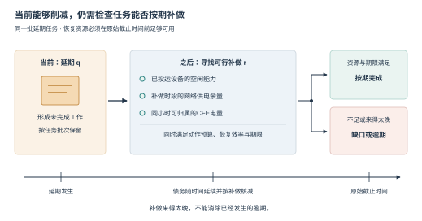

# 智算中心达产过程中的分阶段接入与柔性可交付性研究

更新日期：2026-10-23。项目研究介绍。

## 1 研究背景与项目目标

本项目面向逐步达产的AI智算中心，研究业务增长、计算设备分批投运与电网扩建进度不一致时，业务柔性能否支撑给定的分阶段接入方案，以及任务恢复和小时级清洁电力要求会在哪些阶段限制履约。

AI计算需求增长正在增加电力供应与电网接入压力。IEA《Energy and AI》报告讨论了AI发展与电力需求、基础设施之间的联系[1]；Mytton等进一步指出，数据中心的地理集中和接入需求会使局部电网容量成为约束[2]。对一个具体项目而言，需要解决的问题发生在从建成到满负荷运营的整个达产过程中：业务逐步到达，计算设备分批投运，支撑接入的线路或主变工程则按各自工期建设。

这三种进度可能不同步。例如，设备已经投运、业务已经到达，但电网扩建仍未完成，中心就可能需要在部分小时降低取电。若任务允许延期，可以暂缓部分计算，并在之后补做。然而，补做需要在任务截止时间前同时获得空闲计算设备、供电空间和满足清洁匹配要求的电量。当前能够降低负荷，并不自动保证后续能够完成任务。

达产还会改变柔性的来源与限制。早期业务较少时，可能有更多空闲设备用于补做，也可能因为当期任务太少而没有足够工作可供延期；后期业务增加后，可延期任务变多，设备和供电的恢复余量却可能收紧。如果新增设备及时投运，后者又可能得到缓解。因此，哪个阶段更容易履约，需要结合业务、设备与电网三条路径判断。

本研究以一个固定接入点、少量给定的建设与接入计划为对象，建立逐小时评价方法，回答每项计划在哪些阶段可以履约、在哪些阶段出现缺口，以及限制来自当前响应还是期限内恢复。

图1给出整体研究框架：三条给定进度和共同服务规则进入三种评价，完整时序评价把延期、债务、补做和实际取电连接起来；各方法的阶段判断用于比较，随后冻结方案、容量和策略，在独立路径上检验适用范围。图2—4分别展开恢复机制、进度错位及网络与CFE核查。

**图1 从给定进度到阶段判断与独立检验（整体框架）。** 自上而下依次为共同输入、三种并列评价、阶段判断、冻结后的独立留出。蓝色文件表示任务，橙色文件表示延期债务；补做要满足设备、供电、小时CFE和原始期限要求，债务与预算跨小时延续。电表记录实际取电P，分别接受网络与CFE检查。冻结方案和独立新路径共同进入留出执行，形成适用范围与失败区域。图中表示研究设计。

## 2 相关研究

### 2.1 数据中心柔性与电网接入

围绕数据中心接入，Kim等把业务柔性纳入规划方主导的选址框架[3]；Chen和Zheng比较时间延期与空间转移对电网接入的作用[4]。Wan和Li将时空负荷调整嵌入安全约束机组组合，分析拥塞与系统运行[5]；Williams等则通过实际计算设备与电网信号联动，展示功率柔性控制的实现方式[6]。这些研究已从规划、调度和实际控制三个层面说明，数据中心负荷具有可调节价值。

### 2.2 任务延期、恢复与服务可交付性

Wierman等综述了数据中心参与需求响应的机会与实施限制[7]；Liu等研究任务移峰与本地发电如何共同降低尖峰取电[8]。GreenSlot在任务截止时间内安排批处理工作，以利用可再生能源[9]；Radovanović等把碳感知调度应用于数据中心的时间可移工作负荷[10]。这些工作表明，延期应同时受任务服务要求和后续执行能力约束。

在柔性承诺与服务可交付性方面，Fan和Zhao把工作负荷队列与调频容量承诺共同建模，检查瞬时响应及累计调用后的持续能力[11]。Khanal等在容量扩展研究中纳入柔性任务补做、事件形状及恢复限制，并比较不同电网中柔性的价值[12]。Butt等则在现场光伏、储能与投资预算约束下，把任务期限与最小电网接入容量联系起来[13]。

这些工作将可调负荷与任务队列、补做能力、截止时间及资源配置相联系，使柔性评价从即时削减扩展到后续任务完成与服务承诺。

### 2.3 分期建设与基础设施规划

多阶段输电扩展方法已经能够描述负荷增长和分期投资[14]。在数据中心领域，Vafamehr等研究不确定性下的数据中心模块与数据网络扩展[15]；Shao等联合规划长期数据中心与电力资产发展[16]；Zhao等明确考虑数据中心集群的负荷增长、建设顺序及分阶段能源配置[17]。Zhu等将带工期的输电建设与跨中心任务迁移联合优化[18]；Wang等把大模型规模的不确定增长传递到AI数据中心配套电力基础设施扩展[19]；Ghosh等提出与设备采购和接入工期相衔接的分期工程架构[20]。

这类研究覆盖了模块扩建、建设顺序、输电工期和长期联合投资，描述了需求增长与基础设施逐步形成之间的关系，并把建设进度纳入规划或工程配置。

### 2.4 小时级清洁电力匹配

de Chalendar和Benson讨论了年度可再生能源采购指标的局限[21]；Miller等研究电力消费碳排放的小时核算[22]。Riepin和Brown分析24/7无碳能源采购的方式、成本和系统影响[23]；Riepin等进一步讨论全天候匹配对先进清洁技术采用的作用[24]，并研究面向清洁计算的任务时空移峰[25]。Guo等则在专线供电规划中联动风光储、电网交互与逐小时供电可交付性[26]。

上述工作从核算、采购、运行调度和供电规划等角度，把清洁电力的时间分布与用电安排联系起来，区分了年度电量平衡与更细时间尺度上的匹配要求。

### 2.5 现有研究的不足

综合上述文献，柔性接入、任务恢复、分期建设和小时清洁匹配均已有研究基础。面向单一智算中心从投运到达产的连续过程，现有成果仍需进一步建立以下联系。

第一，**建设进度与运行履约之间的联系。** 规划中的模块扩建、工期和负荷增长描述，为阶段评价提供了基础；但对一项给定接入计划，还需要逐小时说明业务、设备和电网进度错位怎样改变可延期任务与补做资源，才能判断达产各阶段能否连续履约。

第二，**即时响应与期限内恢复之间的联系。** 队列、补做和截止时间已有明确模型；仍需在达产过程中区分当前可延期工作不足与以后恢复资源不足，并检验相同即时可调MW、相近清洁资源总量下，设备、供电和清洁资源的可用时段是否会改变方案判断。

第三，**评价结论与适用范围之间的联系。** 柔性、建设与清洁匹配方面的结果，需要通过共同服务目标下的对照，转化为给定阶段计划的判断依据：简化评价与完整时序评价何时一致、何时不同，以及所选计划在独立新路径上的适用范围，仍是需要明确的评价问题。

### 2.6 本研究切入点

基于这些不足，本研究固定一个接入点，将业务达产、设备投运和电网建设分别作为给定路径，在相同外生任务、期限及清洁资源下评价少量分阶段接入计划。研究聚焦于：**进度错位何时使履约瓶颈从当前可延期工作转向截止时间前的设备、供电或清洁恢复资源，并因此改变对给定计划的判断？** 通过三种评价的匹配对照与冻结策略的独立留出检验，解释这种阶段性瓶颈及其适用边界。

## 3 本文贡献

围绕上述问题，本文拟作以下三方面贡献，具体结论由后续比较与留出结果确定。

1. **构建达产过程的分阶段接入评价框架。** 分别描述业务增长、计算设备投运和电网建设，将各阶段的任务、可用计算能力及建成网络映射到即时响应和期限内恢复条件，形成面向同一接入点、给定建设与接入计划的连续履约评价。

2. **刻画进度错位下的阶段性瓶颈与判断边界。** 在相同外生任务、期限和清洁资源下，区分当前可延期工作、设备能力、网络供电及清洁恢复资源的限制；通过即时调用匹配的机制对照，识别相同即时MW下恢复时序改变方案判断的条件，以及小时级CFE目标对该边界的影响。

3. **界定简化评价与所选计划的适用范围。** 对同一给定计划比较瞬时MW、固定恢复余量和完整时序评价，说明差异是否来自恢复与期限约束；再冻结计划、容量和运行策略，在独立路径上检验适用范围，同时报告判断一致、简化评价足够及履约失败的条件。

## 4 研究对象与基本概念

| 概念 | 本研究中的含义 |
|---|---|
| 业务达产 | 外部到达的计算任务逐步接近目标运营规模；任务量及期限构成共同服务目标。 |
| 设备投运 | 计算模块完成安装和调试后开始提供可执行能力K；未投运设备不提供恢复资源。 |
| 分阶段接入 | 在各阶段给定接入额度，并按实际建成网络及合同条件检查。F为保供部分，X为附带调用条件的部分。 |
| 业务柔性 | 在任务允许的范围内推迟计算，并在原截止时间前完成的能力。 |
| 恢复债务 | 已推迟但尚未完成的计算工作量，按任务到达时间、效率及截止时间持续记录。 |
| 小时级CFE匹配 | 用电目标份额与同小时、适用地域内可归属的无碳电量匹配；CFE为carbon-free energy。 |
| 可交付性 | 在声明的网络、服务及信息条件下，响应、清洁匹配与任务完成能否共同兑现。 |

例如，某小时用电100MWh、匹配目标80%，就需要该小时适用范围内80MWh可归属无碳电量。任务补做增加的用电同样计入。这里核算的是电量属性归属，清洁资源的分配应守恒且避免重复归属。

**图2 延期任务怎样补做（框架运行机制的局部展开）。** 按①当期延期、②以后小时补做、③原期限检查阅读。引线标明同一批橙色任务、设备余量、供电余量、同小时CFE及原始截止时间；青色箭头连接任务状态。三项资源要在补做小时同时可用，还受动作预算和恢复效率约束。右上是按期完成；右下是期限到仍欠任务，记录逾期。晚补做保留逾期，未观察结局保留未决。钟面与文件数量均为示意。

## 5 研究方法

### 5.1 分别描述业务、设备与电网进度

模型采用两至三期设备投运、一个候选电网工程和少量给定接入计划。业务快慢达产与电网按期或延期投运交叉形成机制情景；设备路径单独给定，明确安装、在建与可用状态。投运时间由开工、工期及给定延期共同确定，只有已投运资源进入当期能力。

电网侧在正常状态检查完整F+X，在声明的故障集合下检查F及X允许的条件调用。实际网络决定是否需要削减以及恢复时可获得的供电空间，每项计划均重新计算。业务调节容量D与接入额度X分别定义，二者之间通过任务、用电映射和网络检查建立联系。

**图3 三条进度怎样改变约束（框架输入的局部展开）。** 沿时间轴看同一中心的早期运行、扩建未投运和实际投运后。引线分别指出当期任务w、已投运能力K、施工工程、可能延期q与已投运扩建。下方三步解释任务和设备如何限制当期工作、旧网络如何限制供电，以及投运后为何重算调用和补做条件。债务与预算跨阶段保留；阶段判断仍接受响应、恢复与期限检查。数量和时间间距均为示意。

### 5.2 连接任务执行、延期、补做与实际取电

逐小时记录任务到达、基准业务w、延期q、恢复r和已投运设备K。w、q、r、K及调节容量D采用统一的计算资源参考单位MW_c；该单位通过设备参数映射到计量点的电功率MW。执行与补做满足：

**0≤w−q+r≤K，q+r≤D。**

初始模型采用同一小时在延期与恢复之间择一的运行规则，即q·r=0。q受当期可延期任务比例约束；r受设备剩余能力、补做效率、既有债务及供电条件约束。债务按任务批次累计与核减，逾期后完成仍保留已发生的逾期记录。

计量点取电P包含已投运设备的待机、任务执行、补做和配套耗能。这样，设备投运既增加计算能力，也可能增加用电负担。补做效率影响完成多少原任务工作量，计算资源和电功率之间则用同一设备映射换算。

### 5.3 联合检查网络响应与小时清洁匹配

模型先从当前网络与未响应基准取电计算完整电网调用，再检查物理响应能否覆盖。清洁侧对每个时段检查αPΔt≤y≤Y，其中α为匹配目标，Δt为时段长度，y为实际归属电量，Y为外部给定的可归属上限。P包括待机与补做；比较计划使用相同外部清洁资源及归属规则。

主比较采用明确的独立削减承诺规则：分别承诺给电网和CFE的削减量，要由同一组设备、任务和恢复资源共同兑现；每单位延期工作只分配给其中一项承诺，实际取电只计一次。该规则是本研究的服务情景假设，具体项目的适用性取决于合同和计量依据，并在全部对照中保持一致。

**图4 从计算任务到取电与两类核查（框架约束的局部展开）。** 先看机房、固定接入点电表、外部归属账本的引线标注，再按下方①计算资源、②总取电P、③网络与CFE检查阅读。P包含待机、执行、补做与配套耗能；用电记录与外部同小时额度Y进入清洁核算。正常与故障状态的F/X接入额度按合同另核。粗蓝线表示供电，细虚线表示记录与归属核算。图形为示意，网络判断限于声明的DC模型与故障集合。

### 5.4 保持时间连续与可用信息一致

相邻小时传递任务债务、预算及运行状态，阶段切换不清零。评价窗口提供明确前史，并延续到已登记任务期限及必要后续观察；没有观察到结局的任务标为未决或右删失，已经观察到的违约仍保留。

建设与接入计划在评价前固定。运行策略只使用当时已经观察到的信息；相同观测历史采用相同动作。独立留出路径不参与方案或参数选择，执行时冻结建设计划、容量与运行策略。

## 6 比较设计与结果呈现

主实验在相同外生任务量、任务期限、清洁资源和评价标准下，比较少量给定计划。计划自身的设备和电网投运差异作为研究对象保留。

| 对照 | 要回答的问题 |
|---|---|
| 业务快慢达产×电网按期或延期，分别给定设备路径 | 进度错位在哪一阶段形成瓶颈？ |
| 瞬时MW、固定恢复余量、完整时序评价 | 忽略恢复时段和任务期限，是否改变计划判断？ |
| 匹配即时调用的恢复时序对照 | 相同即时响应条件下，后续设备、供电或清洁窗口是否改变履约？ |
| 可延期比例、期限、CFE目标的必要敏感性 | 判断变化发生在哪里，主要机制是否稳定？ |
| 冻结计划与策略在独立留出路径上执行 | 选定方案对新进度和运行路径是否仍适用？ |

结果按阶段报告接入额度、已投运能力、业务占用、延期与恢复轨迹、网络及CFE缺口、任务逾期和未完成工作。先判断完整合同与任务目标能否满足，再解释约束来源。匹配即时调用的对照单独作为机制诊断；实际计划比较保留网络变化引起的调用差异。只有上下界证据充分时报告最低容量点值，其余保留区间或未决结论。

数据设计使用可追溯的公开电网和工作负荷资料，并分别标明设备功耗、任务期限、阶段进度及清洁归属参数的来源。通过假设配对的跨源数据用于机制情景分析；其等权比较不解释为现实达产率、工程延期率或违约概率。

## 7 预期成果与交付

最终交付包括给定分阶段接入方案的评价模型、阶段性瓶颈与判断边界图、可追溯输入和计算记录，以及完整论文。研究结论以实际对照结果为依据；无差异和失败区域同样报告。网络结论限于声明的DC模型与故障集合，工程应用需结合相应安全校核。

## 参考文献

[1] International Energy Agency (2025). Energy and AI. IEA. <https://www.iea.org/reports/energy-and-ai>

[2] Mytton, D.; Ashtine, M.; Wheeler, S.; Wallom, D. (2023). Stretched grid? Managing data center energy demand and grid capacity. Oxford Open Energy, 2, oiad014. <https://doi.org/10.1093/ooenergy/oiad014>

[3] Kim, D.; Dong, L.; Xie, L. (2026). Flexibility-aware framework for efficient planner-initiated siting of data center. Nature Communications. <https://doi.org/10.1038/s41467-026-72324-9>

[4] Chen, Y.; Zheng, X. (2026). To Defer or To Shift? The Role of AI Data Center Flexibility on Grid Interconnection. DOI: 10.1145/3765611.3815593; arXiv:2604.05376. <https://doi.org/10.1145/3765611.3815593>

[5] Wan, H.; Li, X. (2026). Data Center Spatio-Temporal Load Flexibility in Security-Constrained Unit Commitment for Enhanced Grid Efficiency and Reliability. arXiv:2605.18517. <https://arxiv.org/abs/2605.18517>

[6] Williams, C.; Colangelo, P.; Coskun, A.; et al. (2026). Power-Flexible AI Data Centers: A New Paradigm for Grid-Responsive Compute. arXiv:2606.25098. <https://arxiv.org/abs/2606.25098>

[7] Wierman, A.; Liu, Z.; Liu, I.; Mohsenian-Rad, H. (2014). Opportunities and Challenges for Data Center Demand Response. International Green Computing Conference, 1-10. <https://doi.org/10.1109/IGCC.2014.7039172>

[8] Liu, Z.; Wierman, A.; Chen, Y.; Razon, B.; Chen, N. (2013). Data center demand response: Avoiding the coincident peak via workload shifting and local generation. SIGMETRICS, 341-342. <https://doi.org/10.1145/2465529.2465740>

[9] Goiri, I.; Le, K.; Haque, M. E.; et al. (2011). GreenSlot: Scheduling Energy Consumption in Green Datacenters. SC, Article 20. <https://doi.org/10.1145/2063384.2063411>

[10] Radovanović, A.; Koningstein, R.; Schneider, I.; et al. (2023). Carbon-Aware Computing for Datacenters. IEEE Transactions on Power Systems, 38(2), 1270-1280. <https://doi.org/10.1109/TPWRS.2022.3173250>

[11] Fan, Y.; Zhao, J. (2026). Harnessing Flexible Spatial and Temporal Data Center Workloads for Grid Regulation Services. arXiv:2602.01508v1. <https://arxiv.org/abs/2602.01508v1>

[12] Khanal, S.; Roh, G.; Yao, B.; et al. (2026). Shift or curtail? How much data-center flexibility is worth depends on the host power grid. arXiv:2608.19622v1. <https://arxiv.org/abs/2608.19622v1>

[13] Butt, H. Z.; Fatima, R.; Li, X. (2026). Minimizing Grid Interconnection Capacity Requirements for AI Data Centers: A Developer-Side Planning Framework with Onsite Resources and Workload Flexibility. arXiv:2608.29359v1. <https://arxiv.org/abs/2608.29359v1>

[14] Han, S.; Kim, H.-J.; Lee, D. (2020). A Long-Term Evaluation on Transmission Line Expansion Planning with Multistage Stochastic Programming. Energies, 13(8), 1899. <https://doi.org/10.3390/en13081899>

[15] Vafamehr, A.; Khodayar, M. E.; Manshadi, S. D.; Ahmad, I.; Lin, J. (2019). A Framework for Expansion Planning of Data Centers in Electricity and Data Networks Under Uncertainty. IEEE Transactions on Smart Grid, 10(1), 305-316. <https://doi.org/10.1109/TSG.2017.2738444>

[16] Shao, Z.; Yu, N.; Wong, D. (2025). Stochastic Long-Term Joint Decarbonization Planning for Power Systems and Data Centers: A Case Study in PJM. International Journal of Electrical Power & Energy Systems, 173, 111377. <https://doi.org/10.1016/j.ijepes.2025.111377>

[17] Zhao, H.; Yu, C.; Fu, G.; et al. (2026). Source-Load Coordinated Multi-Stage Low-Carbon Planning for Data Center Clusters Considering Construction Sequence. Energies, 19(17), 4153. <https://doi.org/10.3390/en19174153>

[18] Zhu, M.; Kai, Q.; Liu, Y.; Yan, Y.; Zhao, H. (2026). Virtual Transmission Lines from Data Center Workload Migration: Coordinated Multi-Year Transmission Expansion Planning. arXiv:2610.13032v1. <https://arxiv.org/abs/2610.13032v1>

[19] Wang, Q.; Huang, T.; Liu, Q.; Na, J. (2026). Power-infrastructure expansion planning for training-oriented AI data centers under large-model scaling uncertainty. Energy and AI, 25, 100840. <https://doi.org/10.1016/j.egyai.2026.100840>

[20] Ghosh, S.; Mohammed, N.; Sadi, M. A. H. (2026). A Phased Development Framework Enabling Islanded Operation of Sustainable AI Data Centers With Onsite Grid-Following and Grid-Forming Energy Architectures. arXiv:2607.17391v1. <https://arxiv.org/abs/2607.17391v1>

[21] de Chalendar, J. A.; Benson, S. M. (2019). Why 100% Renewable Energy Is Not Enough. Joule, 3(6), 1389-1393. <https://doi.org/10.1016/j.joule.2019.05.002>

[22] Miller, G. J.; Novan, K.; Jenn, A. (2022). Hourly accounting of carbon emissions from electricity consumption. Environmental Research Letters, 17(4), 044073. <https://doi.org/10.1088/1748-9326/ac6147>

[23] Riepin, I.; Brown, T. (2024). On the means, costs, and system-level impacts of 24/7 carbon-free energy procurement. Energy Strategy Reviews, 54, 101488. <https://doi.org/10.1016/j.esr.2024.101488>

[24] Riepin, I.; Jenkins, J. D.; Swezey, D.; Brown, T. (2025). 24/7 carbon-free electricity matching accelerates adoption of advanced clean energy technologies. Joule, 9, 101808. <https://doi.org/10.1016/j.joule.2024.101808>

[25] Riepin, I.; Brown, T.; Zavala, V. M. (2025). Spatio-temporal load shifting for truly clean computing. Advances in Applied Energy, 17, 100202. <https://doi.org/10.1016/j.adapen.2024.100202>

[26] Guo, F.; Soares, J.; Ma, L.; et al. (2026). Integrated planning of wind-solar-storage-grid systems for private-wire supplied data centers. Applied Energy, 414, 127841. <https://doi.org/10.1016/j.apenergy.2026.127841>
