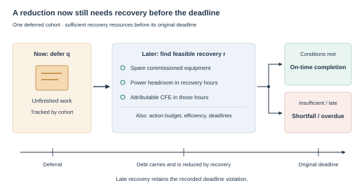
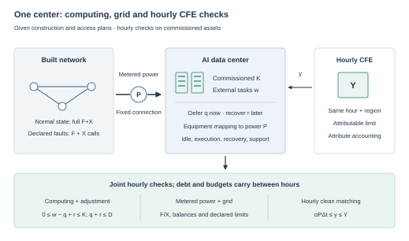

# Assessing Flexibility Deliverability for Staged Interconnection of AI Data Centers During Ramp-Up

Updated: 2026-11-04. Project research introduction. The title follows `agent.md` §2; this revision aligns the deliverability definition and comparison design in Sections 3–6 with the three-valued criterion defined there.

## 1 Background and project objective

This project studies an AI data center as it ramps up toward its target operating scale. It asks whether workload flexibility can support given staged interconnection plans when business growth, computing-equipment commissioning, and grid construction progress at different rates, and which stages are limited by task recovery and hourly clean-electricity requirements.

Growing AI demand places pressure on electricity supply and grid access. The IEA's Energy and AI report examines the links between AI development, electricity demand, and infrastructure [1]. Mytton et al. discuss how geographically concentrated data-center demand can constrain local grid capacity [2]. For an individual project, the issue unfolds throughout ramp-up: tasks arrive gradually, computing modules are commissioned in batches, and supporting lines or transformers follow their own construction schedules.

These paths may become misaligned. Equipment and business may be ready while a grid reinforcement is still under construction, requiring lower electricity withdrawal during some hours. Eligible tasks can be deferred and completed later. Recovery, however, requires spare computing equipment, power headroom, and electricity that meets the clean-matching requirement before the original deadlines. Reducing demand now does not by itself guarantee later task completion.

Ramp-up changes both the source and the limits of flexibility. Early operation may offer spare equipment for recovery but too little eligible work to defer. Later demand growth may increase deferrable work while reducing recovery headroom. Timely equipment additions may ease that pressure. Which stage is more deliverable therefore depends on the relative progress of business, equipment, and the grid.

At one fixed point of interconnection, the project develops an hourly assessment of a small set of given construction and access plans. It checks stage delivery under a specified service contract and operating policy, identifying whether currently deferrable work or recovery resources before the original deadlines limit performance.

Figure 1 shows the research architecture. Three given progress paths and common rules feed parallel assessments. Each method's own judgment is compared with the outcome of replaying its schedule under the actual path's temporal constraints. Plans, capacity, and policies are then frozen for causal execution on independent paths. Figures 2–4 expand task accounting and deadlines, progress mismatch, and metered-power/CFE checks.

**Figure 1 Research architecture for staged interconnection and flexibility deliverability.** (a) Separate business, equipment, and grid paths with common tasks, contracts, and external resources. (b) Three parallel assessments. (c) Temporal checks of each schedule on the actual path: q is deferral, r is recovery, and the dashed arrow carries state to the next hour. (d) Method judgments and actual-path outcomes enter comparison separately, supplying evidence for the proposed contributions. Frozen plans, D, and π jointly enter causal holdout execution with independent new paths. Full F/X contracts receive separate checks. The figure depicts study design.

## 2 Related research

### 2.1 Data-center flexibility and grid interconnection

Kim et al. incorporate workload flexibility into planner-initiated data-center siting [3]. Chen and Zheng compare temporal deferral and spatial shifting for grid interconnection [4]. Wan and Li embed spatial and temporal load adjustments in security-constrained unit commitment to study congestion and operation [5]. Williams et al. demonstrate power-flexibility control by coordinating computing equipment with grid signals [6]. Together, these studies establish the value of flexibility through planning, scheduling, and practical control.

### 2.2 Task deferral, recovery, and service deliverability

Wierman et al. review opportunities and practical constraints for data-center demand response [7]. Liu et al. examine workload shifting together with local generation for reducing peak withdrawal [8]. GreenSlot schedules batch jobs within their deadlines to use renewable energy [9]. Radovanović et al. develop carbon-aware scheduling for temporally flexible data-center workloads [10]. These studies link deferral to service requirements and subsequent execution capability.

For flexibility commitments and service deliverability, Fan and Zhao jointly model workload queues and regulation-capacity commitments, checking instantaneous response and sustainability under cumulative calls [11]. Khanal et al. include workload make-up, event shape, and recovery restrictions in capacity expansion and compare flexibility across host grids [12]. Butt et al. connect task deadlines to minimum interconnection capacity under onsite PV, storage, and an investment budget [13].

These studies connect flexible demand to workload queues, make-up capability, deadlines, and resource allocation, extending assessment from immediate reductions to later task completion and service commitments.

### 2.3 Staged construction and infrastructure planning

Multistage transmission-expansion methods already represent demand growth and staged investment [14]. Vafamehr et al. study uncertain expansion of data-center modules and data networks [15]. Shao et al. jointly plan long-term data-center and power-system development [16]. Zhao et al. explicitly consider cluster load growth, construction sequence, and staged energy-resource additions [17]. Zhu et al. co-optimize transmission construction with lead times and geographic workload migration [18]. Wang et al. propagate uncertain large-model growth into supporting power-infrastructure expansion [19]. Ghosh et al. propose a phased engineering architecture addressing equipment procurement and interconnection lead times [20].

This research covers modular expansion, construction sequencing, transmission lead times, and long-term joint investment. It represents the relationship between growing demand and infrastructure development and incorporates construction progress into planning or engineering configurations.

### 2.4 Hourly clean-electricity matching

De Chalendar and Benson discuss limitations of annual renewable-procurement metrics [21]. Miller et al. study hourly accounting of emissions from electricity consumption [22]. Riepin and Brown analyze procurement strategies, costs, and system effects of 24/7 carbon-free energy [23]. Riepin et al. discuss how round-the-clock matching can encourage advanced clean technologies [24] and investigate spatial and temporal workload shifting for clean computing [25]. Guo et al. coordinate wind, solar, storage, grid exchange, and hourly supply deliverability for private-wire data centers [26].

Across accounting, procurement, scheduling, and supply planning, these studies connect the timing of clean-electricity availability with consumption and distinguish annual energy balances from matching requirements at finer time scales.

### 2.5 Remaining gaps in the existing research

The closest studies incorporate queues and sustained response into capacity commitments [11], make-up and event constraints into capacity expansion [12], deadlines into minimum interconnection capacity [13], and transmission lead times or phased engineering into data-center development [18,20]. They provide a direct basis for this study. The further assessment question is bounded to continuous delivery of a given staged access plan at one data center along separate business, equipment, and grid progress paths.

First, **does the same deferrable share represent flexibility at every ramp-up stage?** Growing demand increases work that can be deferred while using equipment and power headroom needed for later recovery. Equipment additions and grid completion change those limits separately. The study needs to locate transitions between insufficient current work and insufficient recovery before deadlines, and check whether they change delivery outcomes under the specified policy.

Second, **can the timing of recovery resources change delivery when total and peak clean energy are equal?** Recovery requires equipment, power, and clean allocations to be available together before the original deadlines. With immediate requests, delivered deferral, and debt at the start of recovery matched, the effect of shifting clean recovery allocations needs to be tested separately, distinguishing insufficient resources from resources arriving too late.

Third, **under what conditions do simplified assessments change the stage judgment?** For the same given plan, comparisons need to distinguish immediate checks that pass despite violations observed in full replay, cases where a simplified assessment and the complete temporal strategy return different verdicts, and regions of agreement. Both directions are reported as observed. Independent paths then test whether frozen policies encounter similar limits.

### 2.6 Focus of this study

The study fixes one point of interconnection and treats business ramp-up, equipment commissioning, and grid construction as separate given paths. A small set of staged access plans is assessed under the same external tasks, deadlines, and clean resources. The central question is: **under a specified contract and operating policy, which progress combinations create a mismatch between currently deferrable work and work that can be recovered before its original deadline, changing the stage-delivery judgment?** Bottleneck transitions are the central focus. Matched recovery timing tests the mechanism, while comparisons with simplified assessments and independent holdout execution test its applicability.

## 3 Contributions

The study aims to organize its results around three testable contributions. The specified policy's actual task-and-service paths provide the main evidence; full F/X access contracts receive separate checks. The assessment model provides common task, equipment, power, and network constraints. Specific conclusions will depend on the subsequent comparisons and holdout results.

1. **Conditions for transitions in delivery bottlenecks during ramp-up.** Currently deferrable work and equipment, power, and clean recovery resources before the original deadlines are recorded separately. Fast or slow business growth, on-time or delayed grid completion, and given equipment paths are compared to locate stages where the limiting resource changes. The intended result is a bottleneck-transition map indexed by workload occupancy and equipment/grid commissioning conditions, together with tests of whether these changes alter the specified policy's task-and-service outcomes on the actual path.

2. **Delivery differences caused by recovery timing under equal clean resources.** Where matched cases can be constructed, external tasks, equipment and network paths, adjustment capacity D, immediate grid and CFE requests, delivered deferral, and debt at the start of recovery are held fixed. Total and peak clean allocations over the evaluation period are equal, while the timing of clean recovery allocations changes. The intended result identifies when availability before the original deadline changes the outcome of the same recovery debt, specifying the conditions under which hourly CFE affects stage delivery.

3. **Regions where simplified assessments give different judgments.** Instantaneous-MW, fixed-recovery-headroom, and full temporal assessments are compared for the same plan and D. Three values are recorded separately: each method's own verdict, the verdict of its schedule replayed under the actual path's full temporal constraints, and the full temporal strategy's verdict on the same plan. The first comparison asks whether a simplification's own schedule survives the constraints it ignored; the second asks whether a simplification rejects a plan the complete strategy completes. Both simplifications compared here loosen constraints rather than tighten them — instantaneous assessment omits the event envelope, and fixed headroom replaces actual recovery headroom with a constant — so disagreements are expected to concentrate in the direction of a simplified pass with violations observed in replay. Whether the opposite direction occurs depends on the presence of a tightening simplification and is reported as observed rather than assumed. Plans, D, and policies are then frozen for execution on independent paths to test the applicability of these boundaries.

Each proposed contribution has a concrete evidence requirement and a condition for narrowing its interpretation:

| Proposed contribution | Evidence to deliver | Observation requiring a narrower claim |
|---|---|---|
| Stage bottleneck transitions | Stage maps linking progress combinations, limiting resources, and actual task-and-service outcomes | Resource headroom changes while actual-path delivery judgments remain unchanged |
| Recovery-timing effects | Trajectories with matched immediate requests, deferral, recovery-start debt, and total and peak clean resources | Outcomes agree over complete follow-up, or differences accompany uncontrolled changes in requests, starting debt, or resources |
| Simplified-assessment boundaries | Method verdicts, full temporal replay verdicts on the actual path, complete-strategy verdicts, and frozen-policy holdout performance | All verdicts agree in the compared region, or differences cannot be attributed to simplified recovery and deadline conditions |

## 4 Research object and key concepts

| Concept | Meaning in this study |
|---|---|
| Business ramp-up | Externally arriving computing tasks approach the target operating scale; workload and deadlines define the common service objective. |
| Equipment commissioning | A module contributes executable capacity K only after installation and commissioning. |
| Staged interconnection | Given access allowances are checked against the built network and contract conditions. F is the firm portion; X is conditional on specified calls. |
| Workload flexibility | Eligible computation can be postponed and completed before its original deadline. |
| Recovery debt | Deferred but unfinished work, tracked by arrival time, recovery efficiency, and deadline. |
| Hourly CFE matching | A target share of consumption is matched with attributable carbon-free energy from the same hour and eligible region. |
| Deliverability | Under the stated network, service, and information conditions, response, clean matching, and in-deadline recovery are checked hour by hour; each plan–stage–method combination takes one of three values: deliverable, not deliverable, or undetermined. |

For example, an hour with 100 MWh consumption and an 80% target needs 80 MWh of eligible attributable CFE for that hour. Recovery consumption is included. This is energy-attribute accounting; allocation must conserve available resources and avoid duplicate attribution.

The criterion is three-valued. Undetermined covers right-censoring when a deadline has not yet entered the observation window, plus missing solve or check evidence; it counts as neither success nor failure. Task completion reads only the original deadline, and recovery after a deadline does not erase the recorded overdue, so one task cohort can simultaneously show its work fully made up and its overdue retained. All three assessments must be evaluated under the same criterion, window, and accounting rules; each method's own verdict and the verdict of its schedule replayed under the actual path's full temporal constraints are stored separately, and their disagreement is the central object of this study.

**Figure 2 Task debt, concurrent recovery resources, and deadline outcomes.** (a) Deferral, debt, and effective recovery for the same cohort obey work conservation; η is recovery efficiency. (b) Recovery jointly respects commissioned equipment, the built network, hourly clean allocations, and business/action limits. Once the original deadline is observed, remaining work at that time distinguishes on-time completion from overdue work. A deadline outside the observation window is right-censored; missing solve or check results are separately unresolved. Late recovery retains an observed violation. The figure shows mechanism relationships.

## 5 Method

### 5.1 Represent the three progress paths separately

The model uses two or three equipment stages, one candidate grid project, and a small set of given access plans. Fast or slow business growth is crossed with on-time or delayed grid completion. Equipment paths separately define installation, construction, and availability. Commissioning follows the given start, lead time, and delay; only commissioned resources provide current capability.

Normal-state network checks cover the full F+X allowance. The declared contingency set checks F and the contractually permitted calls on X. The built network determines required reductions and power headroom during recovery, recalculated for each plan. Workload adjustment capacity D and access allowance X are distinct, linked through tasks, electricity consumption, and network checks.

**Figure 3 Separate progress paths enter different operating and recovery constraints.** (a) Work, commissioned equipment, and the built network evolve over continuous time; steps illustrate relative timing without a numerical scale. (b) Current tasks limit deferral, equipment determines computing headroom, and the current network and clean allocations jointly constrain recovery supply. Calls and recovery limits are recomputed after actual commissioning. Recovery expressions apply when q=0, with a=γβ. Debt, original deadlines, and event budgets carry across stages.

### 5.2 Link execution, deferral, recovery, and metered power

Hourly states record task arrivals, baseline work w, deferral q, recovery r, and commissioned equipment K. The quantities w, q, r, K, and adjustment capacity D use a common computing-resource reference unit, MW_c. Equipment parameters translate these units into metered electrical MW. Execution and recovery satisfy:

**0≤w−q+r≤K, q+r≤D.**

The initial model uses one aggregate action direction per hour, q·r=0. Deferral is limited by eligible current tasks. Recovery is limited by spare equipment, recovery efficiency, existing debt, and power conditions. Debt is accumulated and cleared by task batch; late completion retains the recorded deadline violation.

Metered power P includes the idle consumption of commissioned equipment, task execution, recovery, and supporting loads. The initial homogeneous-equipment mapping is P=γ[P_idle+β(w−q+r)]+P_aux: β is incremental IT power per unit of active computing effort, γ is the facility-power multiplier, and a=γβ. The term P_aux contains only fixed auxiliary loads outside γ. New equipment can increase both computing capacity and electricity demand. Recovery efficiency determines how much original work is completed, while computing effort is converted to power through this same mapping.

### 5.3 Check network response and hourly clean matching together

The model derives the full grid call from the current network and pre-response baseline power, then checks whether physical response covers it. Clean matching requires 0≤y≤min(Y,PΔt) and αPΔt≤y in each interval: 0≤α≤1 is the target share, Δt the interval duration, y the allocated energy, and Y the externally specified attributable limit. Allocation is bounded by both the external limit and actual consumption. Power P includes idle and recovery consumption. Plans share the same external clean resources and allocation rules.

The main comparison specifies independent reduction commitments: reductions separately promised to the grid and CFE services must be delivered using the same equipment, tasks, and recovery resources. Each unit of deferred work is allocated to one promise, and actual power is counted once. This is an explicit service-scenario assumption, consistently applied across comparisons; applicability to a particular project depends on its contract and metering arrangements.

**Figure 4 Computing resources, metered power, and network/CFE checks.** (a) Workload actions determine computing effort, mapped to P including commissioned idle, execution, recovery, and support consumption. (b) Blue solid arrows denote physical supply; teal dashed arrows denote metering records and attribute accounting. Same-hour allocation y is bounded by both external quota Y and actual consumption PΔt. (c) Grid and CFE deferral promises are allocated separately, while physical P is counted once. Full F/X access contracts receive separate checks. Network judgments remain within the declared DC model and contingency set.

### 5.4 Preserve chronology and information

Task debt, budgets, and operating states carry between adjacent hours and across stage changes. Evaluation has explicit prior history and extends through registered task deadlines and required follow-up. Unobserved outcomes remain unresolved or right-censored; observed violations are retained.

Construction and access plans are fixed before evaluation. The operating policy uses information observed at the time, with identical actions under identical observed histories. Independent holdout paths do not influence plan or parameter selection. Construction plans, capacity, and operating policies are frozen before execution on those paths.

## 6 Comparisons and reporting

Within each given business path, the main experiment compares a small number of given plans under the same external workload, deadlines, clean resources, and evaluation criteria. Plan comparisons are made separately for fast and slow business scenarios. Differences in equipment or grid commissioning remain explicit properties of the plans.

| Comparison | Question addressed |
|---|---|
| Fast/slow business growth × on-time/delayed grid completion, with separate equipment paths | At which stage does progress misalignment become binding? |
| Instantaneous MW, fixed recovery headroom, full temporal assessment (two comparison axes) | Does a simplification's own schedule survive full temporal constraints (method verdict × replay verdict); and does a simplification reject a plan the complete temporal strategy completes (method verdict × strategy verdict)? |
| Recovery timing with matched immediate requests, deferral, recovery-start debt, and total and peak clean resources | With equipment and network paths fixed, does shifting only clean recovery allocations change deadline outcomes? |
| Essential sensitivities in eligible share, deadlines, and CFE target | Where do judgments change, and is the main mechanism stable? |
| Frozen plan and policy executed on independent holdout paths | Does the selected plan remain applicable on new paths? |

Results report access allowances, commissioned capacity, workload occupancy, deferral and recovery trajectories, grid and CFE shortfalls, overdue tasks, and unfinished work by stage, producing bottleneck-transition maps, matched recovery trajectories, and tables of assessment differences. The difference tables report both comparison axes separately and give the counts of every agreement and undetermined region, so no distribution is omitted because one direction did not occur. Method verdicts, actual path performance, and full contract evidence are reported separately; observed violations and unresolved outcomes are retained as distinct states. A fixed policy's failure means that policy did not deliver on that path. Matched recovery-timing cases serve as mechanism diagnostics; actual plan comparisons retain request and resource differences caused by equipment and network changes. Minimum workload-flexibility capacity D is reported as a point only with adequate bounds under the same contract and policy scope; otherwise the result remains an interval or unresolved.

The data design uses traceable public network and workload sources and identifies the origins of equipment-power, deadline, stage-progress, and clean-allocation parameters separately. Cross-source records paired through stated assumptions support mechanism scenarios. Equal-weight comparisons of such scenarios do not estimate real ramp-up, construction-delay, or violation probabilities.

## 7 Expected outputs and deliverables

Deliverables comprise an assessment model for given staged interconnection plans, figures explaining stage-specific bottlenecks and decision boundaries, traceable inputs and computational records, and the complete thesis. Conclusions follow the comparisons, including unchanged judgments and failure regions. Network conclusions are limited to the declared DC model and contingency set; engineering application requires the corresponding safety studies.

## References

[1] International Energy Agency (2025). Energy and AI. IEA. <https://www.iea.org/reports/energy-and-ai>

[2] Mytton, D.; Ashtine, M.; Wheeler, S.; Wallom, D. (2023). Stretched grid? Managing data center energy demand and grid capacity. Oxford Open Energy, 2, oiad014. <https://doi.org/10.1093/ooenergy/oiad014>

[3] Kim, D.; Dong, L.; Xie, L. (2026). Flexibility-aware framework for efficient planner-initiated siting of data center. Nature Communications. <https://doi.org/10.1038/s41467-026-72324-9>

[4] Chen, Y.; Zheng, X. (2026). To Defer or To Shift? The Role of AI Data Center Flexibility on Grid Interconnection. DOI: 10.1145/3765611.3815593; arXiv:2604.05376. <https://doi.org/10.1145/3765611.3815593>

[5] Wan, H.; Li, X. (2026). Data Center Spatio-Temporal Load Flexibility in Security-Constrained Unit Commitment for Enhanced Grid Efficiency and Reliability. arXiv:2605.18517. <https://arxiv.org/abs/2605.18517>

[6] Williams, C.; Colangelo, P.; Coskun, A.; et al. (2026). Power-Flexible AI Data Centers: A New Paradigm for Grid-Responsive Compute. arXiv:2606.25098. <https://arxiv.org/abs/2606.25098>

[7] Wierman, A.; Liu, Z.; Liu, I.; Mohsenian-Rad, H. (2014). Opportunities and Challenges for Data Center Demand Response. International Green Computing Conference, 1-10. <https://doi.org/10.1109/IGCC.2014.7039172>

[8] Liu, Z.; Wierman, A.; Chen, Y.; Razon, B.; Chen, N. (2013). Data center demand response: Avoiding the coincident peak via workload shifting and local generation. SIGMETRICS, 341-342. <https://doi.org/10.1145/2465529.2465740>

[9] Goiri, I.; Le, K.; Haque, M. E.; et al. (2011). GreenSlot: Scheduling Energy Consumption in Green Datacenters. SC, Article 20. <https://doi.org/10.1145/2063384.2063411>

[10] Radovanović, A.; Koningstein, R.; Schneider, I.; et al. (2023). Carbon-Aware Computing for Datacenters. IEEE Transactions on Power Systems, 38(2), 1270-1280. <https://doi.org/10.1109/TPWRS.2022.3173250>

[11] Fan, Y.; Zhao, J. (2026). Harnessing Flexible Spatial and Temporal Data Center Workloads for Grid Regulation Services. arXiv:2602.01508v1. <https://arxiv.org/abs/2602.01508v1>

[12] Khanal, S.; Roh, G.; Yao, B.; et al. (2026). Shift or curtail? How much data-center flexibility is worth depends on the host power grid. arXiv:2608.19622v1. <https://arxiv.org/abs/2608.19622v1>

[13] Butt, H. Z.; Fatima, R.; Li, X. (2026). Minimizing Grid Interconnection Capacity Requirements for AI Data Centers: A Developer-Side Planning Framework with Onsite Resources and Workload Flexibility. arXiv:2608.29359v1. <https://arxiv.org/abs/2608.29359v1>

[14] Han, S.; Kim, H.-J.; Lee, D. (2020). A Long-Term Evaluation on Transmission Line Expansion Planning with Multistage Stochastic Programming. Energies, 13(8), 1899. <https://doi.org/10.3390/en13081899>

[15] Vafamehr, A.; Khodayar, M. E.; Manshadi, S. D.; Ahmad, I.; Lin, J. (2019). A Framework for Expansion Planning of Data Centers in Electricity and Data Networks Under Uncertainty. IEEE Transactions on Smart Grid, 10(1), 305-316. <https://doi.org/10.1109/TSG.2017.2738444>

[16] Shao, Z.; Yu, N.; Wong, D. (2025). Stochastic Long-Term Joint Decarbonization Planning for Power Systems and Data Centers: A Case Study in PJM. International Journal of Electrical Power & Energy Systems, 173, 111377. <https://doi.org/10.1016/j.ijepes.2025.111377>

[17] Zhao, H.; Yu, C.; Fu, G.; et al. (2026). Source-Load Coordinated Multi-Stage Low-Carbon Planning for Data Center Clusters Considering Construction Sequence. Energies, 19(17), 4153. <https://doi.org/10.3390/en19174153>

[18] Zhu, M.; Kai, Q.; Liu, Y.; Yan, Y.; Zhao, H. (2026). Virtual Transmission Lines from Data Center Workload Migration: Coordinated Multi-Year Transmission Expansion Planning. arXiv:2610.13032v1. <https://arxiv.org/abs/2610.13032v1>

[19] Wang, Q.; Huang, T.; Liu, Q.; Na, J. (2026). Power-infrastructure expansion planning for training-oriented AI data centers under large-model scaling uncertainty. Energy and AI, 25, 100840. <https://doi.org/10.1016/j.egyai.2026.100840>

[20] Ghosh, S.; Mohammed, N.; Sadi, M. A. H. (2026). A Phased Development Framework Enabling Islanded Operation of Sustainable AI Data Centers With Onsite Grid-Following and Grid-Forming Energy Architectures. arXiv:2607.17391v1. <https://arxiv.org/abs/2607.17391v1>

[21] de Chalendar, J. A.; Benson, S. M. (2019). Why 100% Renewable Energy Is Not Enough. Joule, 3(6), 1389-1393. <https://doi.org/10.1016/j.joule.2019.05.002>

[22] Miller, G. J.; Novan, K.; Jenn, A. (2022). Hourly accounting of carbon emissions from electricity consumption. Environmental Research Letters, 17(4), 044073. <https://doi.org/10.1088/1748-9326/ac6147>

[23] Riepin, I.; Brown, T. (2024). On the means, costs, and system-level impacts of 24/7 carbon-free energy procurement. Energy Strategy Reviews, 54, 101488. <https://doi.org/10.1016/j.esr.2024.101488>

[24] Riepin, I.; Jenkins, J. D.; Swezey, D.; Brown, T. (2025). 24/7 carbon-free electricity matching accelerates adoption of advanced clean energy technologies. Joule, 9, 101808. <https://doi.org/10.1016/j.joule.2024.101808>

[25] Riepin, I.; Brown, T.; Zavala, V. M. (2025). Spatio-temporal load shifting for truly clean computing. Advances in Applied Energy, 17, 100202. <https://doi.org/10.1016/j.adapen.2024.100202>

[26] Guo, F.; Soares, J.; Ma, L.; et al. (2026). Integrated planning of wind-solar-storage-grid systems for private-wire supplied data centers. Applied Energy, 414, 127841. <https://doi.org/10.1016/j.apenergy.2026.127841>
