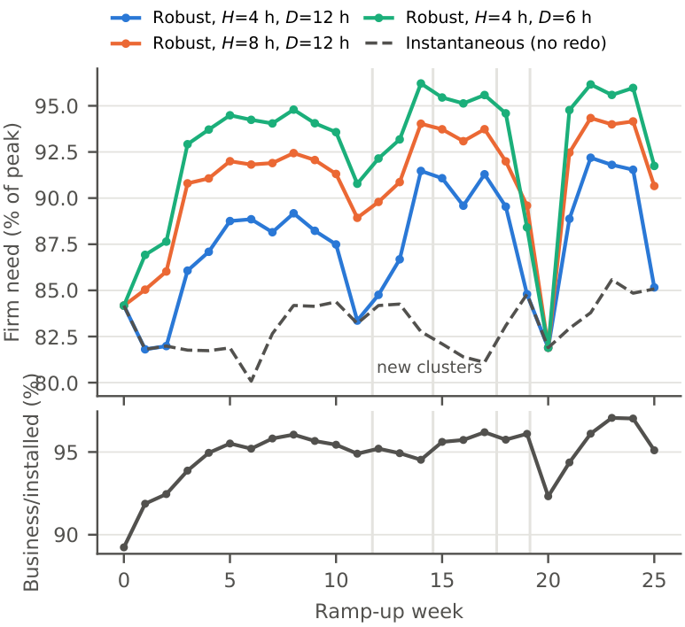
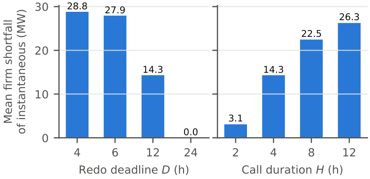

# Ramp-aware robust firm/flexible interconnection design for AI data centers with deadline-constrained workload recovery

## Abstract

Business demand, computing equipment, and grid reinforcement often grow on different schedules during AI data center ramp-up. Flexible interconnection permits curtailment when grid capacity is constrained, but deferred computation must still meet its deadline. Delivering a given curtailment depth therefore depends on spare installed equipment and subsequent import headroom. This paper studies stage-dependent firm capacity and storage design, together with hostable capacity on a given network. Contract calls or N-1 contingencies form the uncertain events in a two-stage adaptive robust model with hourly, deadline-constrained deferral and recovery. Column-and-constraint generation and an exact enumeration adversary solve the declared finite event problem. Under clean-reset conditions, single-call responses construct a non-anticipative policy for repeated calls; clustered calls require multistage treatment. A preliminary feasibility study using load reconstructed from production-cluster traces and the RTS-24 network indicates that the design impact depends on deficit duration, recovery deadlines, and ramp-up state. In the tested contract-call grid, design differences disappear with a 24-hour deadline. The research therefore focuses on conditions that make recovery-aware design necessary and those under which instantaneous assessment suffices.

**Index Terms—** AI data centers, phased interconnection, firm capacity, adaptive robust optimization, workload deferral and recovery, non-anticipativity.

## I. Introduction

Artificial intelligence is increasing data center electricity demand and pressure on local grid connections [1,2]. AI data centers typically undergo sustained ramp-up: business grows, GPUs enter service in batches, and substations and lines follow separate construction schedules. When computing equipment and workload arrive before grid reinforcement, flexible interconnection can provide earlier access by adjusting imports under specified conditions [3]. This arrangement raises an operational question: can curtailed computation be recovered using the remaining resources before its business deadline?

For deferrable work, present curtailment capability and subsequent recovery capability jointly determine whether an interconnection commitment can be delivered. At low business utilization, installed equipment may provide substantial recovery headroom. This headroom shrinks as business fills the equipment and may increase again with new equipment. Consequently, an unchanged contractual curtailment depth can require different firm capacities at different ramp-up stages. Interconnection design must connect the response during a call to completion before the deadline.

### A. Related Work

Data center demand-response research has established that task deferral, load shifting, and local energy resources can adjust grid imports [4,5]. GreenSlot incorporates job deadlines into computing schedules [6]. Recent studies examine how workload recovery, event constraints, and onsite resources affect flexibility value and minimum interconnection capacity [7,8]. These studies provide a basis for representing temporal coupling between deferral and subsequent recovery, and show why completion requirements matter for capacity assessment.

Grid-side flexibility studies address firm and flexible capacity allocation under network and service-quality constraints. Li et al. describe tiered products using an allowed curtailment depth δ and a bound ε on the probability of exceeding it, and solve capacity allocation through aggregation and a CVaR approximation [9]. Their model includes intertemporal generator ramping and a planning-horizon probability event; curtailment within the allowed depth is not frequency-limited. It does not explicitly represent deferred-work backlog, recovery deadlines, or data center ramp-up state. This motivates a direct comparison: for a specified δ/ε product, what depth can the equipment and workload at a particular stage actually deliver? The comparison must also distinguish probabilistic service guarantees from robust guarantees over a specified event set.

Existing research covers several components of workload scheduling and flexible interconnection. This paper examines a specific connection: incorporating both changing spare installed capacity and deadline-constrained recovery into interconnection design, and testing whether this connection changes the capacity decision. Its value must be assessed through both differences and agreement between methods.

### B. Research Question and Approach

The study considers a data center at one point of interconnection. Business demand, installed computing capacity, and grid supply limits are specified separately for each stage. First-stage decisions select firm capacity and optional storage; hourly recourse schedules deferral, recovery, and charging or discharging using information already available. Alternatively, a fixed unit-scale workload and equipment profile can be scaled to determine maximum hostable capacity on a given network.

The central question is whether the duration and depth of a deficit exceed the equipment and supply headroom available before the recovery deadline. A short peak may be absorbed through limited deferral, whereas a persistent deficit can accumulate substantial backlog. The timing of deferrable arrivals, recovery headroom, deadlines, and event information also matters. These temporal constraints provide the basis for studying when recovery-aware design is necessary and when instantaneous assessment suffices.

### C. Present Work and Intended Contributions

The paper formulates ramp-aware robust interconnection design by linking installed GPU capacity, business load, the deferrable share, and recovery deadlines. A common framework addresses firm capacity and storage required by contractual calls, as well as hostable data center capacity under declared N-1 conditions. Given trajectories describe resource differences between stages; the current implementation solves and compares stages independently.

The solution uses column-and-constraint generation (C&CG) [10]. For a finite single-call set, the master chooses capacity and a nominal operating schedule, while the adversary checks every admissible call position and adds the worst event. Repeated calls are handled through conditional clean-reset separability: if each response clears its backlog and restores the nominal state before the next notification can arrive, single-call responses can be concatenated into a non-anticipative policy. Overlapping recovery processes require further treatment of the multistage information structure.

The preliminary study covers contract calls, storage, RTS-24 interconnection, and sensitivity. The next theoretical objective is to derive and test a criterion relating deficit duration and depth to recovery headroom and deadlines. Job-deadline and SLA evidence will define plausible parameter ranges, while a direct tiered-product comparison will quantify deliverable depths at each stage. The criterion and its domain remain to be completed; existing numerical results support this research direction.

## II. System Description and Problem Definition

### A. Ramp-up State and Interconnection Decisions

Each stage is represented by an hourly window with a tail sufficient to observe recovery within the specified deadline. Business IT load is denoted by s, installed IT capacity by K, and the deferrable share by κ. Demand is exogenous, only commissioned equipment provides computing capacity, and normal and contingency grid limits are specified at the interconnection point. Power conversion distinguishes computing resources, IT power, and facility imports.

Capacity design minimizes declared costs over firm capacity F and optional storage energy and power capacities. Hosting-capacity design instead maximizes the scale of a fixed unit-scale workload and equipment profile on a given network. Independent stage solutions provide stage-dependent comparisons with explicit initial and tail conditions. Coupling investment and backlog across stages requires an additional model.

### B. Deferral, Recovery, and Power Balance

Hourly executed work equals nominal business demand minus deferred work plus recovered work, subject to installed capacity. Backlog increases with deferral and decreases with recovery; each deferred batch must be completed within its recovery deadline D. Cumulative deferral and recovery constraints can express this requirement in an hourly formulation. D is measured in hours, and recovery headroom is determined by the equipment and supply available at the time.

Facility imports include execution, idle equipment draw, and supporting facility consumption, together with storage charging and discharging. Storage changes the timing of imports, but workload completion still occupies computing equipment. Design must therefore satisfy power, backlog, deadline, and storage-state constraints together. Initial backlog, terminal backlog, and state-of-charge conditions define feasibility; truncating an observation window does not establish completion.

### C. Call Set and Non-anticipative Response

The contract specifies the maximum number of calls N per stage, call duration H, minimum recovery interval R between calls, and notice lead time n. During a call, firm capacity determines the import limit; normal operation follows the contractual normal import limit. Network cases construct events from declared N-1 supply conditions, fixing contingency types, durations, and permitted responses.

The policy depends only on information already revealed: event paths with the same observable history at a given time must use the same action. A common nominal schedule applies before notification. Exact enumeration covers the declared finite event set; it does not establish coverage of every potential contingency or arbitrary continuous call process.

### D. Repeated Calls and Comparison Principles

Clean reset requires a nominal schedule with no deferral and a single-call response that clears backlog and returns to the nominal state by a specified time no later than the earliest next notification. For a call starting at τ, lasting H hours, followed by a minimum interval R and notice n, the corresponding reset boundary is τ+H+R−n. Without storage, these conditions support the bounds F₁ ≤ F_N ≤ F₁^reset. With storage, the corresponding state of charge must also be restored. When reset conditions cannot be met, repeated-call responses require a multistage non-anticipative formulation.

Comparisons include firm-only, instantaneous, and recovery-aware designs. The instantaneous baseline retains present deferrable-share, equipment, and power limits but omits subsequent recovery obligations; all designs use the same stage data and event sets. Perfect-foresight results are labeled separately. Unconverged problems retain bounds and computational status: failure to converge does not establish infeasibility, and equal optima at finite test points do not imply general equivalence between information structures.

## III. Preliminary Feasibility Evidence and Scope

The feasibility study uses ASI-derived data from 185 days of production-cluster traces [11] and the RTS-24 test network [12]. Data center MW values are reconstructed from computing traces and a power model, rather than measured at a facility meter; scaling the site is also a case-study assumption. Deferrable-load statistics require further mapping to business deadlines and cannot directly establish SLA requirements.

**Fig. 1. Stage-dependent firm capacity in the preliminary study.** The upper panel compares recovery-aware designs and the instantaneous baseline over 26 ramp-up weeks; the lower panel gives the business-to-installed-capacity ratio. Vertical lines indicate new cluster commissioning. Results are reproduced from the current demo, with each H and D combination interpreted separately.

Across the tested RTS-24 cases, flexibility increases hosting capacity by approximately 13%–19% relative to firm-only interconnection. At POI 7, where post-contingency deficits persist for several hours, instantaneous assessment overstates hosting capacity by up to approximately 7%–10%. POI 3 shows no difference; the difference at POI 15 is small, with a maximum no greater than 1.4%. These results suggest the importance of deficit shape. However, some generation-limited or unevaluable hours in the network-capacity series are interpolated, and contingency durations of 4–12 hours are assumed; the results are not engineering safety certification.

**Fig. 2. Mean firm-capacity shortfall of instantaneous assessment over 13 sampled ramp-up weeks.** The left panel varies D at H=4 h; the right varies H at D=12 h. The zero difference at D=24 h applies only to this tested contract-call grid. These means should be distinguished from maxima reported elsewhere.

The gap between the clean-reset upper bound and single-call value is zero in 7 of 21 stage–parameter combinations, no greater than 1% of peak in 15, and at most 9.8%. Two-call cases with R=4 h are still reported through bounds. A separate exact multistage attempt at R=12 h in week 12 had not converged after 10 iterations and approximately 17 minutes. For storage, non-anticipative and perfect-foresight designs have equal optimal values in four tested weeks. The sensitivity parameter β is the cost per MWh of storage energy capacity divided by the cost per MW of firm capacity over the same cost period, with units MW/MWh. At the tested β=0.2, total cost falls by 0.4%–3.6%; at β=0.4, no storage is selected. Actual interconnection and storage costs remain to be calibrated.

These preliminary results support a conditional claim: recovery constraints can change stage-dependent design, with their impact determined jointly by deadlines, event shape, and available headroom. Further work must test the criterion, establish deadline and cost evidence, and compare tiered δ/ε products directly. If actual workloads generally allow long recovery periods, the emphasis should shift toward conditions under which instantaneous assessment is sufficient.

## References

[1] International Energy Agency (2025). Energy and AI. IEA.

[2] Mytton, D.; Ashtine, M.; Wheeler, S.; Wallom, D. (2023). Stretched grid? Managing data center energy demand and grid capacity. Oxford Open Energy, 2, oiad014.

[3] Brancucci, C.; et al. (2025). Flexible data centers: A faster, more affordable path to power. Camus Energy, encoord, and Princeton ZERO Lab, white paper.

[4] Wierman, A.; Liu, Z.; Liu, I.; Mohsenian-Rad, H. (2014). Opportunities and Challenges for Data Center Demand Response. International Green Computing Conference, 1–10.

[5] Liu, Z.; Wierman, A.; Chen, Y.; Razon, B.; Chen, N. (2013). Data center demand response: Avoiding the coincident peak via workload shifting and local generation. SIGMETRICS, 341–342.

[6] Goiri, I.; Le, K.; Haque, M. E.; et al. (2011). GreenSlot: Scheduling Energy Consumption in Green Datacenters. SC, Article 20.

[7] Khanal, S.; Roh, G.; Yao, B.; et al. (2026). Shift or curtail? How much data-center flexibility is worth depends on the host power grid. arXiv:2608.19622v1.

[8] Butt, H. Z.; Fatima, R.; Li, X. (2026). Minimizing Grid Interconnection Capacity Requirements for AI Data Centers: A Developer-Side Planning Framework with Onsite Resources and Workload Flexibility. arXiv:2608.29359v1.

[9] Li, S.; Fang, B.; Qin, J.; Chen, C. (2026). Priority-Aware Firm and Flexible Capacity Quantification for Large-Load Interconnection. arXiv:2611.13673v1.

[10] Zeng, B.; Zhao, L. (2013). Solving two-stage robust optimization problems using a column-and-constraint generation method. Operations Research Letters, 41(5), 457–461.

[11] Li, M. (2026). asi-trace-power: Hourly load and eligible-flexibility reconstruction from the Alibaba cluster-trace-gpu-v2026. Code and data, v1.0.1; companion paper arXiv:2609.05406.

[12] IEEE Reliability Test System Task Force (1979). IEEE reliability test system. IEEE Transactions on Power Apparatus and Systems, 98(6), 2047–2054.
