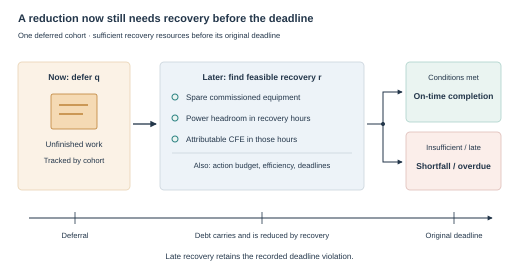

# Staged Interconnection and Flexibility Deliverability During AI Data Center Ramp-Up

Updated: 2026-10-22. Project research introduction.

## 1 Background and project objective

This project studies an AI data center as it ramps up toward its target operating scale. It asks whether workload flexibility can support given staged interconnection plans when business growth, computing-equipment commissioning, and grid construction progress at different rates, and which stages are limited by task recovery and hourly clean-electricity requirements.

Growing AI demand places pressure on electricity supply and grid access. The IEA's Energy and AI report examines the links between AI development, electricity demand, and infrastructure [1]. Mytton et al. discuss how geographically concentrated data-center demand can constrain local grid capacity [2]. For an individual project, the issue unfolds throughout ramp-up: tasks arrive gradually, computing modules are commissioned in batches, and supporting lines or transformers follow their own construction schedules.

These paths may become misaligned. Equipment and business may be ready while a grid reinforcement is still under construction, requiring lower electricity withdrawal during some hours. Eligible tasks can be deferred and completed later. Recovery, however, requires spare computing equipment, power headroom, and electricity that meets the clean-matching requirement before the original deadlines. Reducing demand now does not by itself guarantee later task completion.

**Figure 1 How three progress paths create access pressure (conceptual illustration).** Read time from left to right and business, equipment, and grid states from top to bottom. In the pale orange window, tasks have grown and additional equipment is commissioned while grid reinforcement remains under construction. The study asks whether a given access plan can deliver through this mismatch. Spacing and icon counts illustrate states rather than measured durations or quantities; grid completion alone does not establish full delivery.

Ramp-up changes both the source and the limits of flexibility. Early operation may offer spare equipment for recovery but too little eligible work to defer. Later demand growth may increase deferrable work while reducing recovery headroom. Timely equipment additions may ease that pressure. Which stage is more deliverable therefore depends on the relative progress of business, equipment, and the grid.

At one fixed point of interconnection, the project develops an hourly assessment of a small set of given construction and access plans. It identifies the stages in which each plan can deliver, the shortfalls that arise, and whether immediate response or recovery before deadlines is responsible.

## 2 Related research, remaining questions, and project focus

### 2.1 Flexibility can support access, with benefits shaped by network and operating conditions

Kim et al. incorporate workload flexibility into planner-initiated data-center siting [3]. Chen and Zheng compare temporal deferral and spatial shifting for grid interconnection [4]. Wan and Li embed spatial and temporal load adjustments in security-constrained unit commitment to study congestion and operation [5]. Williams et al. demonstrate power-flexibility control by coordinating computing equipment with grid signals [6]. Together, these studies establish the value of flexibility through planning, scheduling, and practical control.

For an individual center during ramp-up, access conditions must also be linked to the equipment and tasks actually available at each stage. Siting benefits, operation in a target year, or a control demonstration do not directly establish delivery throughout a ramp-up path. This project therefore recalculates response and recovery conditions on the network actually built at each stage and assesses given staged access allowances at a fixed connection point.

### 2.2 Task deferral and recovery are established; their resources must be placed within ramp-up

Wierman et al. review opportunities and practical constraints for data-center demand response [7]. Liu et al. examine workload shifting together with local generation for reducing peak withdrawal [8]. GreenSlot schedules batch jobs within their deadlines to use renewable energy [9]. Radovanović et al. develop carbon-aware scheduling for temporally flexible data-center workloads [10]. These studies link deferral to service requirements and subsequent execution capability.

Closer work addresses deliverability directly. Fan and Zhao jointly model workload queues and regulation-capacity commitments, checking instantaneous response and sustainability under cumulative calls [11]. Khanal et al. include workload make-up, event shape, and recovery restrictions in capacity expansion and compare flexibility across host grids [12]. Butt et al. connect task deadlines to minimum interconnection capacity under onsite PV, storage, and an investment budget [13]. Queues, make-up, and deadlines thus already have direct precedents.

This project asks how those recovery conditions change during ramp-up. Commissioned computing capacity, current business occupancy, the built grid, and clean resources available before deadlines must be represented in one chronology. The assessment tests whether identical instantaneous flexible MW imply identical delivery at different stages. Matched comparisons between instantaneous-MW, fixed-recovery-headroom, and full temporal assessments distinguish insufficient deferrable work now from insufficient recovery resources later.

### 2.3 Staged construction and joint planning are established; given plans need stage-specific delivery assessment

Multistage transmission-expansion methods already represent demand growth and staged investment [14]. Vafamehr et al. study uncertain expansion of data-center modules and data networks [15]. Shao et al. jointly plan long-term data-center and power-system development [16]. Zhao et al. explicitly consider cluster load growth, construction sequence, and staged energy-resource additions [17]. Zhu et al. co-optimize transmission construction with lead times and geographic workload migration [18]. Wang et al. propagate uncertain large-model growth into supporting power-infrastructure expansion [19]. Ghosh et al. propose a phased engineering architecture addressing equipment procurement and interconnection lead times [20].

These studies already cover modular expansion, construction sequencing, transmission lead times, and long-term joint investment. The present project addresses a specific operating question: at one connection point, can a given access plan maintain delivery before task deadlines when business, computing-equipment, and grid progress are misaligned? The three progress paths are inputs to the assessment. Their effects on current response and later recovery are traced while construction and access plans remain fixed for evaluation.

### 2.4 Hourly clean matching is established; recovery must be checked in its available hours

De Chalendar and Benson discuss limitations of annual renewable-procurement metrics [21]. Miller et al. study hourly accounting of emissions from electricity consumption [22]. Riepin and Brown analyze procurement strategies, costs, and system effects of 24/7 carbon-free energy [23]. Riepin et al. discuss how round-the-clock matching can encourage advanced clean technologies [24] and investigate spatial and temporal workload shifting for clean computing [25]. Guo et al. coordinate wind, solar, storage, grid exchange, and hourly supply deliverability for private-wire data centers [26].

For tasks with deadlines, total clean energy alone is insufficient to describe recovery opportunities. Even with the same total and peak attributable clean energy, different arrival times may change which tasks can be recovered. Spare equipment hours may also lack power headroom or clean-matching resources. This project therefore treats clean matching as an hourly delivery requirement, accounts for idle, current-work, and recovery consumption together, and checks its interaction with equipment commissioning, workload occupancy, and grid conditions.

### 2.5 The specific question addressed here

The literature establishes methods for flexible access, workload recovery, staged construction, and hourly clean matching. This project examines their connection during ramp-up: **when demand growth and commissioning on both sides are misaligned, does the binding limit move from currently deferrable work to equipment, power, or clean recovery resources before deadlines, changing the assessment of a given staged access plan?**

The intended contribution is an explanation of these stage-specific bottlenecks and decision boundaries. Evidence must come from matched comparisons with the same external tasks and clean resources, showing when a difference appears, which constraint causes it, and whether it persists on new paths. Where full temporal assessment leaves plan judgments unchanged, the study also identifies the conditions under which a simpler assessment is adequate.

## 3 Research object and key concepts

| Concept | Meaning in this study |
|---|---|
| Business ramp-up | Externally arriving computing tasks approach the target operating scale; workload and deadlines define the common service objective. |
| Equipment commissioning | A module contributes executable capacity K only after installation and commissioning. |
| Staged interconnection | Given access allowances are checked against the built network and contract conditions. F is the firm portion; X is conditional on specified calls. |
| Workload flexibility | Eligible computation can be postponed and completed before its original deadline. |
| Recovery debt | Deferred but unfinished work, tracked by arrival time, recovery efficiency, and deadline. |
| Hourly CFE matching | A target share of consumption is matched with attributable carbon-free energy from the same hour and eligible region. |
| Deliverability | Response, clean matching, and task completion can be met together under the stated network, service, and information conditions. |

For example, an hour with 100 MWh consumption and an 80% target needs 80 MWh of eligible attributable CFE for that hour. Recovery consumption is included. This is energy-attribute accounting; allocation must conserve available resources and avoid duplicate attribution.

**Figure 2 Why a reduction now still requires recovery before deadlines (conceptual illustration).** Deferral q creates unfinished work tracked by cohort. Subsequent recovery r requires commissioned equipment, network power headroom, and attributable CFE in the recovery hours, subject to the action budget, recovery efficiency, and original deadlines. The right branches show alternative outcomes: on-time completion when conditions permit, or shortfall or overdue work when resources are insufficient or late. The timeline emphasizes continuous debt accounting; late recovery retains an observed deadline violation.

## 4 Research questions

First, which stages of a given plan become constrained under fast or slow business growth, phased equipment commissioning, and on-time or delayed grid completion? The assessment separates tasks not yet arrived, equipment shortages, network supply limits, and recovery limits before deadlines.

Second, do the same instantaneous flexible MW represent the same delivery capability at different ramp-up stages? The study distinguishes currently deferrable work from equipment, power, and clean resources before deadlines and examines how the hourly CFE target moves that boundary.

Third, do instantaneous-MW, fixed-recovery-headroom, and full temporal assessments reach different judgments about the same given plan? What is the range of applicability when the frozen plan and operating policy are executed on independent new paths?

## 5 Method

### 5.1 Represent the three progress paths separately

The model uses two or three equipment stages, one candidate grid project, and a small set of given access plans. Fast or slow business growth is crossed with on-time or delayed grid completion. Equipment paths separately define installation, construction, and availability. Commissioning follows the given start, lead time, and delay; only commissioned resources provide current capability.

Normal-state network checks cover the full F+X allowance. The declared contingency set checks F and the contractually permitted calls on X. The built network determines required reductions and power headroom during recovery, recalculated for each plan. Workload adjustment capacity D and access allowance X are distinct, linked through tasks, electricity consumption, and network checks.

**Figure 3 How resources and constraints connect at one center (assessment framework).** The built grid supplies the center through a fixed connection point, where P denotes metered power. On the right, Y and y denote the hourly attributable CFE limit and allocation; this arrow represents attribute accounting. Equipment, tasks, deferral, and recovery determine P, including idle and supporting loads. The lower band shows the main computing, network, and clean-matching checks; debt and budgets carry across hours. K, w, q, r, and D use MW_c; P uses MW; y and Y use MWh, with Δt in hours. Network conclusions remain within the declared DC model and contingency set.

### 5.2 Link execution, deferral, recovery, and metered power

Hourly states record task arrivals, baseline work w, deferral q, recovery r, and commissioned equipment K. The quantities w, q, r, K, and adjustment capacity D use a common computing-resource reference unit, MW_c. Equipment parameters translate these units into metered electrical MW. Execution and recovery satisfy:

**0≤w−q+r≤K, q+r≤D.**

The initial model uses one aggregate action direction per hour, q·r=0. Deferral is limited by eligible current tasks. Recovery is limited by spare equipment, recovery efficiency, existing debt, and power conditions. Debt is accumulated and cleared by task batch; late completion retains the recorded deadline violation.

Metered power P includes the idle consumption of commissioned equipment, task execution, recovery, and supporting loads. New equipment can therefore increase both computing capacity and electricity demand. Recovery efficiency determines how much original work is completed, while one consistent equipment mapping converts computing effort into power.

### 5.3 Check network response and hourly clean matching together

The model derives the full grid call from the current network and pre-response baseline power, then checks whether physical response covers it. Clean matching requires αPΔt≤y≤Y in each interval: α is the target share, Δt the interval duration, y the allocated energy, and Y the externally specified attributable limit. Power P includes idle and recovery consumption. Plans share the same external clean resources and allocation rules.

The main comparison specifies independent reduction commitments: reductions separately promised to the grid and CFE services must be delivered using the same equipment, tasks, and recovery resources. Each unit of deferred work is allocated to one promise, and actual power is counted once. This is an explicit service-scenario assumption, consistently applied across comparisons; applicability to a particular project depends on its contract and metering arrangements.

### 5.4 Preserve chronology and information

Task debt, budgets, and operating states carry between adjacent hours and across stage changes. Evaluation has explicit prior history and extends through registered task deadlines and required follow-up. Unobserved outcomes remain unresolved or right-censored; observed violations are retained.

Construction and access plans are fixed before evaluation. The operating policy uses information observed at the time, with identical actions under identical observed histories. Independent holdout paths do not influence plan or parameter selection. Construction plans, capacity, and operating policies are frozen before execution on those paths.

## 6 Comparisons and reporting

The main experiment compares a small number of given plans under the same external workload, deadlines, clean resources, and evaluation criteria. Differences in equipment or grid commissioning remain explicit properties of the plans.

| Comparison | Question addressed |
|---|---|
| Fast/slow business growth × on-time/delayed grid completion, with separate equipment paths | At which stage does progress misalignment become binding? |
| Instantaneous MW, fixed recovery headroom, full temporal assessment | Do omitted recovery timing and deadlines change the plan judgment? |
| Recovery-timing comparisons with matched immediate calls | Can later equipment, power, or clean windows change delivery under identical immediate response? |
| Essential sensitivities in eligible share, deadlines, and CFE target | Where do judgments change, and is the main mechanism stable? |
| Frozen plan and policy executed on independent holdout paths | Does the selected plan remain applicable on new paths? |

Results report access allowances, commissioned capacity, workload occupancy, deferral and recovery trajectories, grid and CFE shortfalls, overdue tasks, and unfinished work by stage. Full contract and task delivery are assessed before attributing a bottleneck. Matched-call cases serve as mechanism diagnostics; actual plan comparisons retain calls that change with the network. Minimum capacity is reported as a point only with adequate bound evidence; otherwise the result remains an interval or unresolved.

The data design uses traceable public network and workload sources and identifies the origins of equipment-power, deadline, stage-progress, and clean-allocation parameters separately. Cross-source records paired through stated assumptions support mechanism scenarios. Equal-weight comparisons of such scenarios do not estimate real ramp-up, construction-delay, or violation probabilities.

**Figure 4 Which comparisons answer the research question (study design).** Step 1 fixes given plans and comparable inputs, deadlines, and service rules. Step 2 compares instantaneous-MW, fixed-recovery-headroom, and full temporal assessments. Step 3 explains the stages and constraints behind judgment differences, retaining null and failure regions. Step 4 freezes plans and operating policies before causal execution on independent holdout paths. The dashed divider separates selection from holdout evaluation. The lower band lists intended outputs; specific judgments require subsequent computational evidence.

## 7 Intended contributions and deliverables

The study seeks three results: an explicit link from business, equipment, and grid stage states to access deliverability; identification of when recovery resources before deadlines change a plan judgment despite the same immediate MW capability; and the applicability of frozen plans on independent paths, including conditions under which instantaneous or fixed-headroom assessments suffice.

Deliverables comprise an assessment model for given staged interconnection plans, figures explaining stage-specific bottlenecks and decision boundaries, traceable inputs and computational records, and the complete thesis. Conclusions follow the comparisons, including unchanged judgments and failure regions. Network conclusions are limited to the declared DC model and contingency set; engineering application requires the corresponding safety studies.

## References

[1] International Energy Agency (2025). Energy and AI. IEA. <https://www.iea.org/reports/energy-and-ai>

[2] Mytton, D.; Ashtine, M.; Wheeler, S.; Wallom, D. (2023). Stretched grid? Managing data center energy demand and grid capacity. Oxford Open Energy, 2, oiad014. <https://doi.org/10.1093/ooenergy/oiad014>

[3] Kim, D.; Dong, L.; Xie, L. (2026). Flexibility-aware framework for efficient planner-initiated siting of data center. Nature Communications. <https://doi.org/10.1038/s41467-026-72324-9>

[4] Chen, Y.; Zheng, X. (2026). To Defer or To Shift? The Role of AI Data Center Flexibility on Grid Interconnection. DOI: 10.1145/3765611.3815593; arXiv:2604.05376. <https://doi.org/10.1145/3765611.3815593>

[5] Wan, H.; Li, X. (2026). Data Center Spatio-Temporal Load Flexibility in Security-Constrained Unit Commitment for Enhanced Grid Efficiency and Reliability. arXiv:2605.18517. <https://arxiv.org/abs/2605.18517>

[6] Williams, C.; Colangelo, P.; Coskun, A.; et al. (2026). Power-Flexible AI Data Centers: A New Paradigm for Grid-Responsive Compute. arXiv:2606.25098. <https://arxiv.org/abs/2606.25098>

[7] Wierman, A.; Liu, Z.; Liu, I.; Mohsenian-Rad, H. (2014). Opportunities and Challenges for Data Center Demand Response. International Green Computing Conference, 1-10. <https://doi.org/10.1109/IGCC.2014.7039172>

[8] Liu, Z.; Wierman, A.; Chen, Y.; Razon, B.; Chen, N. (2013). Data center demand response: Avoiding the coincident peak via workload shifting and local generation. SIGMETRICS, 341-342. <https://doi.org/10.1145/2465529.2465740>

[9] Goiri, I.; Le, K.; Haque, M. E.; et al. (2011). GreenSlot: Scheduling Energy Consumption in Green Datacenters. SC, Article 20. <https://doi.org/10.1145/2063384.2063411>

[10] Radovanović, A.; Koningstein, R.; Schneider, I.; et al. (2023). Carbon-Aware Computing for Datacenters. IEEE Transactions on Power Systems, 38(2), 1270-1280. <https://doi.org/10.1109/TPWRS.2022.3173250>

[11] Fan, Y.; Zhao, J. (2026). Harnessing Flexible Spatial and Temporal Data Center Workloads for Grid Regulation Services. arXiv:2602.01508v1. <https://arxiv.org/abs/2602.01508v1>

[12] Khanal, S.; Roh, G.; Yao, B.; et al. (2026). Shift or curtail? How much data-center flexibility is worth depends on the host power grid. arXiv:2608.19622v1. <https://arxiv.org/abs/2608.19622v1>

[13] Butt, H. Z.; Fatima, R.; Li, X. (2026). Minimizing Grid Interconnection Capacity Requirements for AI Data Centers: A Developer-Side Planning Framework with Onsite Resources and Workload Flexibility. arXiv:2608.29359v1. <https://arxiv.org/abs/2608.29359v1>

[14] Han, S.; Kim, H.-J.; Lee, D. (2020). A Long-Term Evaluation on Transmission Line Expansion Planning with Multistage Stochastic Programming. Energies, 13(8), 1899. <https://doi.org/10.3390/en13081899>

[15] Vafamehr, A.; Khodayar, M. E.; Manshadi, S. D.; Ahmad, I.; Lin, J. (2019). A Framework for Expansion Planning of Data Centers in Electricity and Data Networks Under Uncertainty. IEEE Transactions on Smart Grid, 10(1), 305-316. <https://doi.org/10.1109/TSG.2017.2738444>

[16] Shao, Z.; Yu, N.; Wong, D. (2025). Stochastic Long-Term Joint Decarbonization Planning for Power Systems and Data Centers: A Case Study in PJM. International Journal of Electrical Power & Energy Systems, 173, 111377. <https://doi.org/10.1016/j.ijepes.2025.111377>

[17] Zhao, H.; Yu, C.; Fu, G.; et al. (2026). Source-Load Coordinated Multi-Stage Low-Carbon Planning for Data Center Clusters Considering Construction Sequence. Energies, 19(17), 4153. <https://doi.org/10.3390/en19174153>

[18] Zhu, M.; Kai, Q.; Liu, Y.; Yan, Y.; Zhao, H. (2026). Virtual Transmission Lines from Data Center Workload Migration: Coordinated Multi-Year Transmission Expansion Planning. arXiv:2610.13032v1. <https://arxiv.org/abs/2610.13032v1>

[19] Wang, Q.; Huang, T.; Liu, Q.; Na, J. (2026). Power-infrastructure expansion planning for training-oriented AI data centers under large-model scaling uncertainty. Energy and AI, 25, 100840. <https://doi.org/10.1016/j.egyai.2026.100840>

[20] Ghosh, S.; Mohammed, N.; Sadi, M. A. H. (2026). A Phased Development Framework Enabling Islanded Operation of Sustainable AI Data Centers With Onsite Grid-Following and Grid-Forming Energy Architectures. arXiv:2607.17391v1. <https://arxiv.org/abs/2607.17391v1>

[21] de Chalendar, J. A.; Benson, S. M. (2019). Why 100% Renewable Energy Is Not Enough. Joule, 3(6), 1389-1393. <https://doi.org/10.1016/j.joule.2019.05.002>

[22] Miller, G. J.; Novan, K.; Jenn, A. (2022). Hourly accounting of carbon emissions from electricity consumption. Environmental Research Letters, 17(4), 044073. <https://doi.org/10.1088/1748-9326/ac6147>

[23] Riepin, I.; Brown, T. (2024). On the means, costs, and system-level impacts of 24/7 carbon-free energy procurement. Energy Strategy Reviews, 54, 101488. <https://doi.org/10.1016/j.esr.2024.101488>

[24] Riepin, I.; Jenkins, J. D.; Swezey, D.; Brown, T. (2025). 24/7 carbon-free electricity matching accelerates adoption of advanced clean energy technologies. Joule, 9, 101808. <https://doi.org/10.1016/j.joule.2024.101808>

[25] Riepin, I.; Brown, T.; Zavala, V. M. (2025). Spatio-temporal load shifting for truly clean computing. Advances in Applied Energy, 17, 100202. <https://doi.org/10.1016/j.adapen.2024.100202>

[26] Guo, F.; Soares, J.; Ma, L.; et al. (2026). Integrated planning of wind-solar-storage-grid systems for private-wire supplied data centers. Applied Energy, 414, 127841. <https://doi.org/10.1016/j.apenergy.2026.127841>
