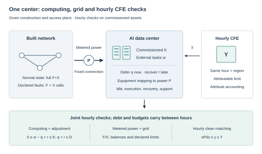
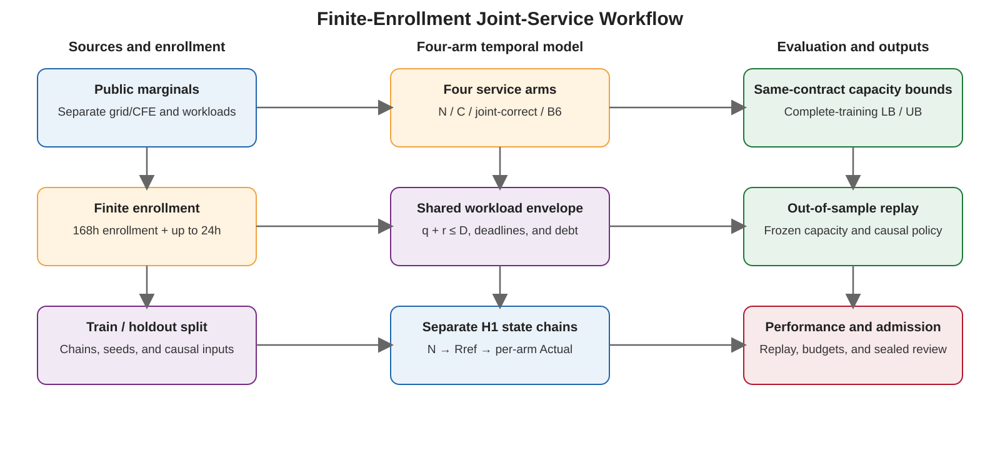

# Deliverability of Workload Flexibility for Staged AI Data Center Interconnection During Ramp-Up

Updated: 2026-10-22. Research design and current progress.

## 1 Project purpose

This project studies an AI data center whose business demand grows toward full operation while computing equipment and grid infrastructure are commissioned on different schedules. It asks whether workload flexibility can support a given staged interconnection plan, and how task recovery and hourly carbon-free energy (CFE) requirements limit delivery.

Business growth, equipment commissioning, and grid expansion follow three distinct trajectories. Computing equipment and customer demand may arrive before a supporting line or transformer is ready. Alternatively, grid capacity may be available before the center reaches its intended operating scale. The study represents these trajectories separately and compares plans against the same business service requirements.

Workload flexibility postpones eligible computation within its deadline. For example, the center may defer tasks during a constrained grid hour and complete them later. This reduces immediate electricity demand but creates unfinished work. Recovery requires computing headroom, available power, and sufficient attributable clean electricity before the deadline.

A staged plan therefore depends on both immediate demand reduction and later task completion. Recovery headroom may shrink when business grows faster than equipment capacity, but additional equipment can offset this effect. An early operating stage is not inherently more flexible: demand and commissioned equipment must be considered separately.

The study fixes the connection point and evaluates a small set of given construction and interconnection plans. Its outputs identify which stages meet the stated obligations, where shortfalls occur, and which constraints explain them.

## 2 Basic concepts

| Concept | Meaning in this study |
|---|---|
| Business ramp-up | External task demand increases toward the target operating scale. Demand cannot be reduced to make a plan appear feasible. |
| Equipment commissioning | Installed and tested modules become executable capacity K. Uncommissioned equipment provides no recovery capacity. |
| Staged interconnection | Access is released as equipment and grid infrastructure become available. A given plan may specify firm capacity F and conditional capacity X. |
| Workload flexibility | Postponing eligible computation and completing it by its original deadline. |
| Recovery debt | Unfinished deferred work, tracked by arrival time and deadline. |
| Hourly CFE matching | Matching a target share of each hour's consumption with attributable carbon-free generation in the same hour and applicable region. |
| Deliverability | Meeting response, clean-energy accounting, and task completion requirements within the stated network, service, and information boundaries. |

CFE eligibility follows the chosen accounting rules. Matching attributes electricity; it does not trace physical electrons. For example, consumption of 100 MWh with an 80% target requires 80 MWh of eligible attributable generation in that hour. Recovery consumption also counts.

**Figure 1 Ramp-up, equipment, and grid progress determine stage resources.** Construction and access trajectories are inputs. Hourly checks connect immediate reductions with later recovery and evaluate the given plan.

## 3 Research questions

First, at which stages do different combinations of business ramp-up, equipment commissioning, and on-time or delayed grid expansion constrain a given interconnection plan? The evaluation distinguishes unrealized demand, insufficient equipment, restricted grid supply, and inadequate recovery resources.

Second, does the same instantaneous MW flexibility imply the same deliverability at different stages? The study identifies whether the binding constraint is currently deferrable work or equipment, power, and clean-energy resources before task deadlines. It also examines how the hourly CFE target moves these boundaries.

Third, can an instantaneous-MW assessment or a fixed recovery-headroom assumption change the judgment about a staged plan? Matched comparisons with a full temporal assessment test whether stage acceptance or the comparison between plans changes.

## 4 Research approach

### 4.1 Three given progress trajectories

The slow timescale describes business demand, equipment commissioning, and grid project status. The initial scope uses two or three equipment stages, one candidate grid project, and a small number of fixed access plans. Fast and slow ramp-up are crossed with on-time and delayed grid completion. Equipment trajectories are specified separately and must maintain consistent installation and availability states.

The built network constrains the access that can be released and delivered; commissioned equipment K constrains task execution and recovery. Unfinished projects provide no additional capacity, and later commissioning cannot erase earlier service shortfalls. Existing F/X semantics apply: the normal state checks F+X, while the declared contingency states check F and permitted conditional calls on X. Workload capacity D and access capacity X are reported separately; relationships among equipment, work, and access require explicit mappings and network checks.

### 4.2 Hourly execution, deferral, and recovery

The operating layer tracks task arrivals, execution, deferral, and recovery. Let q denote deferred power-equivalent work and r the power consumed for recovery. They share a bidirectional adjustment capacity D:

**q+r≤D.**

Deferral is limited by eligible current work. Recovery is limited by commissioned equipment headroom, task compatibility, efficiency, and power supply. With baseline occupancy w in a common power-equivalent convention, current execution plus recovery must satisfy w-q+r≤K. Headroom released by q is counted once. Recovery debt is reduced using the declared efficiency, and late completion does not erase a missed deadline.

The K constraint uses power-equivalent computing resources; K is distinct from total meter-side electricity consumption P. The equipment-to-work-to-power mapping must be established before the main experiments. The main model will include commissioned-equipment idle power, task execution, and supporting loads in its actual power balance, so additional K can also increase electricity demand. This mapping remains an integration task; normalized examples are not calibrated equipment models.

### 4.3 Network and hourly clean-energy checks

For each construction state, the model recalculates available network capability, required reductions, and the power available for recovery. Response rules remain consistent, but requests can change with the actual network and load. Different construction plans cannot all inherit an unchanged request trace without justification.

The main experiments will account for actual electricity consumption, including recovery and idle power in P; this will be verified with the equipment mapping. Plans use the same external clean-resource trajectory and attribution rules. Any allocation must conserve attributes and avoid double attribution; a plan cannot create clean resources through its own demand reduction. For target share α, consumption P, and attributable clean electricity Y, the check is αP≤Y.

The service accounting rule must also be fixed. The existing operating study uses a specific contract in which independently promised grid and CFE reductions must both be delivered using one set of tasks, adjustment capacity, and recovery resources. The initial evaluation retains this named rule. Applying it to a particular project requires contract and metering evidence. Whether one reduction can count toward both services changes the obligation and cannot silently vary between plans.

### 4.4 Information and time continuity

Construction plans are specified before evaluation. Operating decisions use only information observed at that time. Paths with the same observed history must receive the same actions; future clean-energy peaks or delays cannot be used retrospectively to choose favorable recovery schedules.

Adjacent hours carry debt, budgets, and operating states forward. Widely separated stage windows need explicit prior states and enough follow-up to assess task deadlines. Debt cannot be carried across unmodeled gaps or cleared automatically. Continuous operation across a stage boundary must use physically adjacent hours.

## 5 Experimental comparisons

Plans are compared using the same external task demand, deadlines, clean resources, and evaluation standards. Differences in equipment and grid commissioning are retained as differences between plans. A small end-to-end case and measurements of the complete computation path precede selection of the main experiment size.

| Comparison | Question |
|---|---|
| Fast/slow ramp-up × on-time/delayed grid completion | At which stage does a progress mismatch bind, given the equipment trajectory? |
| Instantaneous MW, fixed recovery headroom, and full temporal assessment | Does omitting recovery space or deadlines change the assessment of the same plan? |
| Limited changes in deferrable share, deadlines, and hourly CFE target | Where do judgments change, and does the proposed explanation persist? |
| Fixed construction plans and policies on independent held-out paths | Does the selected plan continue to meet response, CFE, and task completion requirements? |

Network-only, CFE-only, joint shared-resource, and separate-accounting diagnostics remain available to explain the two services. Stage combinations and parameter points will be specified after the small case is validated. The existing 1,900 parameter cells and their evidence retain their original definitions.

Held-out paths do not participate in plan selection. Evaluation does not reoptimize the given construction plan; it executes the frozen operating policy using information observed at the time. Outputs include access allocations, commissioned capacity, business occupancy, recovery headroom, network and CFE shortfalls, overdue tasks, and unfinished work at each stage. A successful policy establishes performance only over its verified cases; an algorithmic failure does not prove that every policy fails. Minimum flexibility is reported as a point only when sufficient bound evidence exists, otherwise as an interval or unresolved status.

Existing public foundations include RTS-GMLC network data, Alibaba workloads, and Google power data. These are paired under stated assumptions rather than treated as observations from the same site and time. Stage paths, equipment power, task deadlines, and attribution are labeled by source or mechanism assumption. Equal-weight synthetic cases are not empirical ramp-up, delay, or default probabilities.

**Figure 2 Evaluation from given stage paths to plan judgments.** Comparable inputs and service definitions precede continuous operating checks. Stage bottlenecks and plan differences are interpreted after the complete computation cost is measured.

## 6 Existing foundations and remaining work

The project has specifications for staged F/X, candidate grid projects, and nonanticipativity; selected-contingency DC operating benchmarks; and code for task deferral, recovery debt, and hourly CFE. Coupled one-to-three-hour synthetic cases and saved-state replay have been checked. These are development validations, not formal interconnection-capacity or service-risk results.

An exactly checked six-hour example illustrates recovery timing. Two deferred jobs of 0.1 each require minimum bidirectional capacity of either 0.1 or 0.2 when the timing of clean recovery resources changes but their total and peak remain fixed. An additional example holds baseline occupancy at 0.2: increasing commissioned K from 0.3 to 0.4 permits a case that previously lacked recovery headroom. These normalized examples omit idle power, construction lead times, and investment optimization; they do not establish real project recommendations.

In the earlier operating study, 1,856 of 1,900 CFE-related parameter cells are excluded by a local necessary condition at one hour because too little work can be deferred. This is a local arithmetic check; it has not established that the paired inputs can reach the corresponding network and reference operating states. It is neither 1,856 realized operating failures nor an experiment on the current staged plans. The other 44 cells are merely not excluded by that condition; network-only remains unresolved. Resource and workload mappings must be clarified before interpreting recovery effects, while preserving the earlier negative evidence.

Remaining work connects the three progress trajectories to operation, specifies the equipment-work-power mapping, validates a small case independently, and performs bounded stage comparisons. The existing 168-hour enrollment and up-to-24-hour follow-up chain still lacks a closed resource budget and full operating acceptance. New stage experiments require their own explicit design and budget. No full formal capacity frontier, empirical default probability, or engineering safety certification is available.

## 7 Prior work and intended contribution

Task shifting, recovery, hourly clean-energy matching, and construction planning all have direct precedents. Fan and Zhao connect workload queues with grid-service capacity commitment [DC14]; Khanal et al. include make-up and event constraints in capacity expansion [DC15]; Riepin et al. study shifting for clean computing [CFE05]. Shao et al. jointly plan long-term power-system and data-center investment [DC17]; Zhu et al. combine transmission construction with spatial migration [DC19]; Butt et al. link onsite resources, task deadlines, and minimum interconnection capacity [DC22].

The specific question is whether a mismatch between business ramp-up and equipment/grid commissioning shifts the bottleneck from immediate reduction to recovery resources before deadlines, and changes the assessment of given staged plans at one connection point. Intended contributions are an explicit connection between stage resources and deliverability; matched plan judgments that differ despite equal instantaneous MW capability; and applicability boundaries for frozen plans on independent held-out paths.

These are hypotheses to be tested. If full recovery constraints do not change plan judgments, the scope of their effect must be reported accordingly. If differences arise only from larger immediate requests, they cannot be attributed to recovery timing. Combining established components is not itself a priority claim; the contribution depends on controlled comparisons and reproducible explanations.

## 8 Execution and deliverables

The sequence begins with service definitions and data mappings, followed by one complete small case containing stage changes, response, recovery, and CFE checks, with measured computation costs. A bounded set of stage plans and contrasts then forms the main experiment. Policies are subsequently frozen and evaluated on new paths before the figures and thesis are completed.

Deliverables are an evaluation method for given staged interconnection plans, stage bottlenecks and applicability boundaries, traceable computation records, and a complete thesis. Construction progress enters as an input; joint optimization of future investment starts is a further research direction. Network conclusions are limited to the declared DC model and contingency set; engineering use requires the corresponding complete safety checks.

## References

[DC14] Fan, Y.; Zhao, J. (2026). Harnessing Flexible Spatial and Temporal Data Center Workloads for Grid Regulation Services. arXiv:2602.01508. https://arxiv.org/html/2602.01508

[DC15] Khanal, S.; Roh, G.; Yao, B.; et al. (2026). Shift or curtail? How much data-center flexibility is worth depends on the host power grid. arXiv:2608.19622v1. https://arxiv.org/html/2608.19622

[CFE05] Riepin, I.; Brown, T.; Zavala, V. M. (2025). Spatio-temporal load shifting for truly clean computing. Advances in Applied Energy, 17, 100202. https://doi.org/10.1016/j.adapen.2024.100202

[DC17] Shao, Z.; Yu, N.; Wong, D. (2025). Stochastic Long-Term Joint Decarbonization Planning for Power Systems and Data Centers: A Case Study in PJM. International Journal of Electrical Power & Energy Systems, 173, 111377. https://doi.org/10.1016/j.ijepes.2025.111377

Model comparison uses arXiv:2510.25118v1. https://arxiv.org/html/2510.25118v1

[DC19] Zhu, M.; Kai, Q.; Liu, Y.; Yan, Y.; Zhao, H. (2026). Virtual Transmission Lines from Data Center Workload Migration: Coordinated Multi-Year Transmission Expansion Planning. arXiv:2610.13032v1. https://arxiv.org/html/2610.13032v1

[DC22] Butt, H. Z.; Fatima, R.; Li, X. (2026). Minimizing Grid Interconnection Capacity Requirements for AI Data Centers: A Developer-Side Planning Framework with Onsite Resources and Workload Flexibility. arXiv:2608.29359v1. https://arxiv.org/abs/2608.29359

Project evidence: [literature library](../../docs/literature/literature_matrix.csv), [construction evidence table](../../docs/literature/construction_evidence_20261021.csv), and [existing evidence and small examples](../../docs/plan/RQ2_创新性核查与研究判断_20261021.md).
