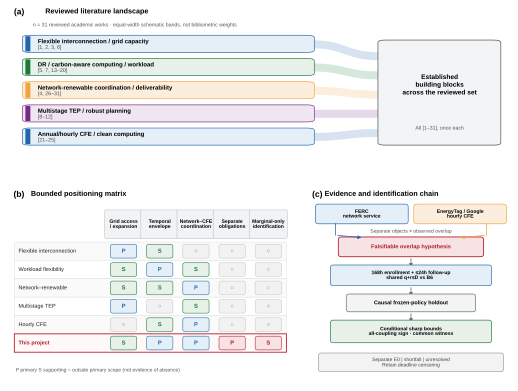

# Deliverability of AI Data Center Workload Flexibility for Grid Response and Carbon-Free Energy Matching

Updated: 2026-10-21. This introduction explains the current thesis question, approach, and progress.

## 1 Project purpose

This project asks how much workload adjustment capacity an AI data center needs to meet both grid response obligations and hourly carbon-free energy (CFE) matching requirements. Workload flexibility means moving eligible computing tasks to later hours while meeting their deadlines. Postponed computation remains unfinished work: reducing demand now creates a need to complete that work, and consume electricity, later.

For example, an eligible task could pause during a constrained grid hour and resume later. If the recovery hours also lack attributable clean electricity, or the task deadline is too close, the promised adjustment may fail. This hypothetical example shows why current demand reduction and later task completion must be assessed on the same timeline.

Both obligations may draw on the same tasks. The grid may require demand reductions during constrained hours, while insufficient attributable CFE may motivate shifting computation to other hours. Separate plans may each allocate the full flexible resource, although their combined execution can encounter insufficient deferrable work, recovery space, or time. Their timing may also relieve existing constraints. The study therefore measures joint capacity requirements and the direction and magnitude of these interactions. The present thesis fixes the grid connection point and concentrates on delivery over time, including recovery.

## 2 Basic concepts

| Concept | Meaning in this study |
|---|---|
| Workload flexibility | Adjusting when eligible computation runs while completing it by its deadline. |
| Grid response | Reducing data center demand as required under stated grid constraints, with checks on the resulting grid state. |
| Hourly CFE matching | Matching a target share of each hour's electricity consumption with attributable carbon-free generation in the same hour and applicable region. |
| Recovery and recovery debt | Recovery completes postponed computation; recovery debt records unfinished work and its deadlines. |
| Deliverability | Meeting defined calls, grid checks, and task deadlines under the stated model and information constraints. |

CFE is broader than renewable electricity alone; eligible sources depend on the accounting boundary. Matching concerns electricity attribution rather than tracing physical electrons. For illustration, consuming 100 MWh in an hour with an 80% target requires 80 MWh of attributable CFE within the relevant hour and region. This is illustrative arithmetic, not a study result. Workload shifting must also leave enough time, computing headroom, and, where applicable, CFE-compatible electricity for recovery.

**Figure 1. One workload resource for two electricity requirements.** Grid conditions and the modeled hourly CFE allowance both affect task scheduling. The resulting commitments are checked against the same tasks, power capacity, and deadlines.

## 3 Three research questions

The current thesis organizes the joint deliverability problem into three questions.

First, how does the minimum required workload flexibility change as the hourly CFE target increases under fixed grid response requirements? The study seeks a frontier that distinguishes demonstrated delivery, bounded capacity requirements, and unresolved regions, and examines how deferrable workload and spare capacity for recovery alter it.

Second, how much additional capacity requirement or relief arises from serving both obligations, relative to the more demanding individual service? What signed capacity difference arises when separate planning is compared with a model that shares physical resources correctly? Neither the ordering of capacities nor the direction of the accounting bias is assumed.

Third, can the capacity and policy selected during training deliver in unseen scenarios? Evaluation distinguishes grid response shortfalls, CFE shortfalls, joint service outcomes, and unfinished computation, establishing the conditions under which the planning conclusions remain useful.

## 4 Methods and comparison schemes

### 4.1 A continuous hourly model

The model connects grid operation, service calls, task postponement, and recovery. Its primary quantity is bidirectional workload adjustment capacity D. Curtailment power q and recovery power r share the constraint q+r≤D. Separate restrictions cover deferrable workload availability, deadlines, event duration and frequency, cumulative budgets, and recovery headroom. Recovery also requires spare computing capacity and, where applicable, sufficient CFE-compatible electricity in the recovery hour. An isolated MW limit therefore cannot establish complete delivery.

Each evaluation enrolls applicable requests and resulting postponed work over 168 consecutive hours. Up to 24 additional hours are observed when needed to determine enrolled outcomes, giving at most 192 simulated hours. Tasks are due 24 hours after creation. Debt and budgets persist across days. New work during follow-up continues to consume physical resources without recursively enlarging the enrolled scoring set. Missing necessary follow-up leaves the corresponding outcome unknown or right-censored; observed violations remain recorded.

Decisions use only information already revealed. Within each scheme and parameter cell, a capacity claim requires one scheduling rule using only currently known information that delivers across all declared training scenarios. Selecting separate actions after learning each scenario's future would not satisfy this requirement.

### 4.2 Four comparison schemes

| Scheme | Role and treatment |
|---|---|
| Grid response only (network-only) | Serves grid response alone to identify its workload flexibility requirement. |
| Hourly matching only (CFE-only) | Serves hourly CFE matching alone to identify its requirement. |
| Joint commitments with shared resources (joint-correct) | Adds two separate service commitments and delivers them within one shared workload availability, capacity, debt, and timing budget. |
| Separate-account planning (joint-B6) | Plans the services in separate accounts, each using full capacity and availability, regenerates actual actions from common service requests and one current workload state, using one shared physical resource. |

The joint comparison adopts a specific additive commitment assumption: separately promised service quantities must both be delivered. This is a benchmark for separate obligations, rather than a universal rule for physical co-service or a resource optimum across all possible arrangements. The separate-account scheme measures the consequences of planning each obligation independently. Its actual actions are regenerated from common requests and one current workload state. Planning feasibility and successful shared execution are evaluated separately.

### 4.3 Scenarios and evaluation

The target-versus-capacity curve places the hourly CFE target on the horizontal axis and required workload adjustment capacity on the vertical axis. Comparing curves across workload limits will help explain whether current curtailment or later recovery is the main bottleneck.

The study uses RTS-GMLC grid data, Alibaba workload data, and Google power data through explicit modeling assumptions. These are modeled pairings, not observations of a joint distribution at one location and time. The 250 MW workload mapping is a simulation scale; business parameters are also stated as mechanism assumptions.

The current exploratory design comprises nine combinations of deferrable fraction and recovery headroom, plus ten changes to individual parameters. Each of these 19 parameter sets uses 100 hourly CFE targets from 1% to 100%, producing 1,900 cells. Computation distinguishes valid lower bounds under the same complete contract, upper bounds witnessed by a complete delivering policy, and unresolved cases. Failure of one algorithm or fixed policy does not establish universal infeasibility.

Training and holdout scenarios remain separate. Capacity and policy are frozen after training evidence is established, then evaluated on holdout scenarios. Reports distinguish grid, CFE, and joint service shortfalls and unfinished work. Interpretation remains conditional on the declared support and mechanism assumptions.

**Figure 2. Research plan for joint workload flexibility.** The four schemes use the same external scenarios and applicable workload rules. After comparing capacity requirements, the selected plans are evaluated in new scenarios for grid response, clean-electricity matching, and task completion.

## 5 Relation to existing research

Three established research areas provide the immediate foundations. Data center demand response, batch scheduling, and carbon-aware computing show how computation can be rescheduled and how power, duration, and recovery limits affect flexibility [5,7,13–20]. Flexible interconnection and capacity planning examine how conditional demand adjustment changes connection locations, capacity, and expansion choices [1–3,6]. Annual and hourly clean-electricity studies examine how the accounting interval changes procurement and workload scheduling [21–25].

The closest work also covers joint congestion relief and renewable utilization, service commitments, and deliverability [4,26–31]. Fan and Zhao [30] link workload allocation to grid-service capacity commitments. Khanal et al. [31] represent duration, recovery, and annual limits in flexible capacity expansion. Building on these foundations, this study asks a specific question: under fixed grid-response rules, how does the required workload flexibility change as hourly CFE targets rise? It separates the limiting individual service, joint timing effects, and separate-account bias, then evaluates whether a selected plan delivers in new scenarios.

FERC network-service documents and the hourly accounting methods of EnergyTag and Google separately support the two institutional requirements. Direct evidence is still needed to establish their overlap within a real shared contract, metering boundary, and workload. This project therefore studies stated mechanism rules and retains that condition when interpreting results. Transmission expansion and robust planning [8–12] provide related grid planning methods.

**Figure 3. Related research and the project's question.** The upper panel groups the 31 reviewed academic works; the lower panels show the themes and how this study connects the two service requirements. Grouping explains research relationships. Schematic band widths do not represent publication counts or evidence strength.

## 6 Current progress

As of 21 October 2026, planning and workload shifting model components exist, alongside DC grid benchmarks for a specified set of selected N-1 contingencies. Connected synthetic examples cover the initial hour and two-hour and three-hour sequences, including selected outage, repair, recovery debt, and unresolved branch cases. Saved results have also been reopened and replayed for verification. These cases check that the workflow follows its intended rules. They constitute synthetic development evidence and do not establish formal capacity or service-risk findings.

The complete continuous 168-hour enrollment with up to 24 hours of follow-up, the production resource budget, formal capacity frontiers, and fixed-policy holdout results remain incomplete. Current work profiles repeated source checks and historical replay to support workflow optimization. There is no measured full 192-hour execution time or formal capacity or service risk result.

## 7 Expected outputs and scope

Expected outputs are target-versus-capacity frontiers, signed attribution across the four schemes, fixed-policy delivery outcomes in new scenarios, and records that trace inputs, carried states, and recovery outcomes. Together they should identify when workload flexibility can support both obligations and which workload or timing constraints limit delivery.

The next steps proceed in order. First, verify the computational workflow and safe reuse of repeated checks, and establish the total resource budget. On that basis, complete the connected week-long simulation and subsequent task recovery, checking cross-day state and missing-data handling. Then calculate capacity requirements and defensible ranges under the current parameter design. Finally, fix the plan selected during training and evaluate both services and task completion in new scenarios.

Conclusions apply to the stated task rules, data scenarios, and grid-check scope. A capacity range is reported when only a range is established; missing evidence remains unknown. Deliverability means fulfilling the defined obligations under those conditions. Engineering security additionally requires full contingency coverage, AC analysis, and equipment and control checks.

## 8 References

[1] Kim, D., Dong, L. and Xie, L. (2026). “Flexibility-aware framework for efficient planner-initiated siting of data center.” Nature Communications. https://doi.org/10.1038/s41467-026-72324-9

[2] Chen, Y. and Zheng, X. (2026). “To Defer or To Shift? The Role of AI Data Center Flexibility on Grid Interconnection.” ACM Sustainability Week. https://doi.org/10.1145/3765611.3815593; https://arxiv.org/abs/2604.05376

[3] Li, S., Fang, B. and Chen, C. (2026). “Risk-Aware Allocation of Transmission Capacity for AI Data Centers.” arXiv preprint arXiv:2604.08854. https://arxiv.org/abs/2604.08854

[4] Wan, H. and Li, X. (2026). “Data Center Spatio-Temporal Load Flexibility in Security-Constrained Unit Commitment for Enhanced Grid Efficiency and Reliability.” arXiv preprint arXiv:2605.18517. https://arxiv.org/abs/2605.18517

[5] Williams, C., Colangelo, P., Coskun, A. et al. (2026). “Power-Flexible AI Data Centers: A New Paradigm for Grid-Responsive Compute.” arXiv preprint arXiv:2606.25098. https://arxiv.org/abs/2606.25098

[6] Mytton, D., Ashtine, M., Wheeler, S. and Wallom, D. (2023). “Stretched grid? Managing data center energy demand and grid capacity.” Oxford Open Energy. https://doi.org/10.1093/ooenergy/oiad014

[7] Crozier, C. and Liska, M. (2025). “The Potential of Data Center Energy Demand To Provide Grid Flexibility.” Current Sustainable/Renewable Energy Reports. https://doi.org/10.1007/s40518-025-00258-9

[8] Han, S., Kim, H.-J. and Lee, D. (2020). “A Long-Term Evaluation on Transmission Line Expansion Planning with Multistage Stochastic Programming.” Energies. https://doi.org/10.3390/en13081899

[9] Webster, M. (2022). “A Multistage Stochastic Transmission Expansion Algorithm for Wide-Area Planning under Uncertainty.” Technical report. https://doi.org/10.2172/1737833

[10] Akhavizadegan, F., Wang, L. and McCalley, J. (2020). “Scenario Selection for Iterative Stochastic Transmission Expansion Planning.” Energies. https://doi.org/10.3390/en13051203

[11] Jabr, R. A. (2013). “Robust Transmission Network Expansion Planning With Uncertain Renewable Generation and Loads.” IEEE Transactions on Power Systems. https://doi.org/10.1109/TPWRS.2013.2267058

[12] Li, W., Zhao, L., Bo, Y. et al. (2021). “Robust transmission expansion planning model considering multiple uncertainties and active load.” Global Energy Interconnection. https://doi.org/10.1016/j.gloei.2021.11.009

[13] Wierman, A., Liu, Z., Liu, I. and Mohsenian-Rad, H. (2014). “Opportunities and Challenges for Data Center Demand Response.” 2014 International Green Computing Conference, pp. 1–10. https://doi.org/10.1109/IGCC.2014.7039172

[14] Liu, Z., Wierman, A., Chen, Y. et al. (2013). “Data center demand response.” ACM SIGMETRICS. https://doi.org/10.1145/2465529.2465740

[15] Goiri, I., Le, K., Haque, M. E. et al. (2011). “GreenSlot.” SC Conference. https://doi.org/10.1145/2063384.2063411

[16] Goiri, I., Katsak, W., Le, K. et al. (2013). “Parasol and GreenSwitch.” ASPLOS. https://doi.org/10.1145/2451116.2451123

[17] Qureshi, A., Weber, R., Balakrishnan, H. et al. (2009). “Cutting the electric bill for internet-scale systems.” ACM SIGCOMM. https://doi.org/10.1145/1592568.1592584

[18] Liu, Z., Lin, M., Wierman, A. et al. (2011). “Geographical load balancing with renewables.” ACM SIGMETRICS Performance Evaluation Review. https://doi.org/10.1145/2160803.2160862

[19] Radovanović, A., Koningstein, R., Schneider, I. et al. (2023). “Carbon-Aware Computing for Datacenters.” IEEE Transactions on Power Systems. https://doi.org/10.1109/TPWRS.2022.3173250; https://arxiv.org/abs/2106.11750

[20] Kwag, H.-G. and Kim, J.-O. (2012). “Optimal combined scheduling of generation and demand response with demand resource constraints.” Applied Energy. https://doi.org/10.1016/j.apenergy.2011.12.075

[21] de Chalendar, J. A. and Benson, S. M. (2019). “Why 100% Renewable Energy Is Not Enough.” Joule. https://doi.org/10.1016/j.joule.2019.05.002

[22] Miller, G. J., Novan, K. and Jenn, A. (2022). “Hourly accounting of carbon emissions from electricity consumption.” Environmental Research Letters. https://doi.org/10.1088/1748-9326/ac6147

[23] Riepin, I. and Brown, T. (2024). “On the means, costs, and system-level impacts of 24/7 carbon-free energy procurement.” Energy Strategy Reviews. https://doi.org/10.1016/j.esr.2024.101488; https://arxiv.org/abs/2403.07876

[24] Riepin, I., Jenkins, J. D., Swezey, D. and Brown, T. (2025). “24/7 carbon-free electricity matching accelerates adoption of advanced clean energy technologies.” Joule. https://doi.org/10.1016/j.joule.2024.101808

[25] Riepin, I., Brown, T. and Zavala, V. M. (2025). “Spatio-temporal load shifting for truly clean computing.” Advances in Applied Energy, 17, 100202. https://doi.org/10.1016/j.adapen.2024.100202; https://arxiv.org/abs/2405.00036

[26] Wan, H., Fang, L. and Li, X. (2025/2026). “Grid Operational Benefit Analysis of Data Center Spatial Flexibility: Congestion Relief, Renewable Energy Curtailment Reduction, and Cost Saving.” arXiv preprint arXiv:2511.08759, v1 2025-11-11, v2 2026-03-27. https://arxiv.org/abs/2511.08759

[27] Ma, D., Ye, Y., Wu, Y. et al. (2025). “Bi-Level Optimisation Model for Harvesting Spatial-Temporal Load Shifting Flexibility of Data Centres Using Endogenously Formed Locational Price Signal.” IET Smart Grid, 8(1), e70020. https://doi.org/10.1049/stg2.70020

[28] Lin, L. and Chien, A. A. (2025). “Distribution and Management of Datacenter Load Decoupling.” arXiv preprint arXiv:2511.08936. https://arxiv.org/abs/2511.08936

[29] Zhang, W., Fang, L., Zhao, F. et al. (2025). “Operational risk assessment of power system considering transmission limitation on flexible resources and its application to SCUC.” AIP Advances, 15, 115016. https://doi.org/10.1063/5.0302342

[30] Fan, Y. and Zhao, J. (2026). “Harnessing Flexible Spatial and Temporal Data Center Workloads for Grid Regulation Services.” arXiv preprint arXiv:2602.01508. https://arxiv.org/html/2602.01508

[31] Khanal, S., Roh, G., Yao, B. et al. (2026). “Shift or curtail? How much data-center flexibility is worth depends on the host power grid.” arXiv preprint arXiv:2608.19622. https://arxiv.org/html/2608.19622

## 9 Institutional and Standards Sources

- Federal Energy Regulatory Commission (2026). 195 FERC ¶ 61,216; Docket EL26-69-000, Order Instituting Proceeding Under Section 206 of the Federal Power Act. https://www.ferc.gov/sites/default/files/2026-06/EL26-69-000.pdf
- EnergyTag (2024). Granular Certificate Matching Standard, Version 1. https://energytag.org/wp-content/uploads/2024/03/Granular-Certificate-Matching-Standard_V1.pdf
- Google (2021). 24/7 Carbon-Free Energy: Methodologies and Metrics. https://sustainability.google/reports/24x7-carbon-free-energy-methodologies-metrics/

## 10 Sources for Design and Progress

- [Research scope and primary-paper focus](../../agent.md): the current research scope and evidence boundaries;
- [Finite-v2 contract](../../configs/rq2_finite_mechanism_protocol_candidate_v2.DRAFT.yaml) and [model specification](../../docs/model_spec/rq2_finite_mechanism_protocol_candidate_v2.md): 168h, 24h, q+r≤D, 1,900 cells, and development authorization;
- [Execution plan](../../docs/plan/科研项目执行步骤.md) and [blocker register](../../docs/model_spec/blocker_register.md): stage evidence, open issues, and closure conditions;
- [H1 end-to-end milestones](../../docs/plan/H1_端到端里程碑验收_v1.md): acceptance order from complete hour-0 to formal execution;
- [Chain_07 retained timing](../../results/tables/rq2_h1_hour0_end_to_end_v2_non_authoritative/chain_07/timing.jsonl) and [source-boundary check](../../results/tables/rq2_h1_hour0_end_to_end_v2_non_authoritative/source_boundary_status_rechecked_01.json): development progress and approved source coverage;
- [Complete hour-0 report](../../results/tables/rq2_h1_hour0_end_to_end_v2_non_authoritative/chain_07/complete_integration_report_supplement_04.md) and [independent supplement 04](../../results/tables/rq2_h1_hour0_end_to_end_v2_non_authoritative/chain_07/postcheck_supplement_completion_04.json): the synthetic first-hour chain and independent-process saved replay;
- [Two-hour batch-replay acceptance](../../results/tables/rq2_h1_cross_hour_batch_v2_non_authoritative/acceptance_report.md) and [machine-readable postcheck](../../results/tables/rq2_h1_cross_hour_batch_v2_non_authoritative/connected_01_postcheck.json): six paired lane-hours and saved-state comparisons;
- [Three-hour outage and repair acceptance](../../results/tables/rq2_h1_cross_hour_outage_v1_non_authoritative/acceptance_report.md) and [machine-readable postcheck](../../results/tables/rq2_h1_cross_hour_outage_v1_non_authoritative/connected_03_postcheck.json): seven paired lane-hours, lane stopping, missing input, and same-process read-only reopen;
- [B0-B2 results](../../results/tables/rts24_b0_b2_summary.json), [B3-B5 results](../../results/tables/rts24_b3_b5_summary.json), and [24-hour DC benchmark](../../results/tables/rts_gmlc_google_day0_full24h_selected_n1_dc_scuc_v1/summary.json): original evidence for the existing grid and planning calculations.

### Supplementary explanation of capacity measures

The four capacities are D_N for grid-only, D_C for CFE-only, D_J for shared joint commitments, and D_B for separate-account planning. The larger individual-service requirement is the comparison baseline. The decomposition is \(I_{joint}=D_J-\max(D_N,D_C)=I_{sep}+A_{B6}\), where \(I_{sep}=D_B-\max(D_N,D_C)\) and \(A_{B6}=D_J-D_B\). Capacity evidence determines the signs.

The current design contains 19 workload parameter sets and 100 hourly CFE targets, totaling 1,900 cells. The linked sources retain the precise parameters, data support, and original computational records.
