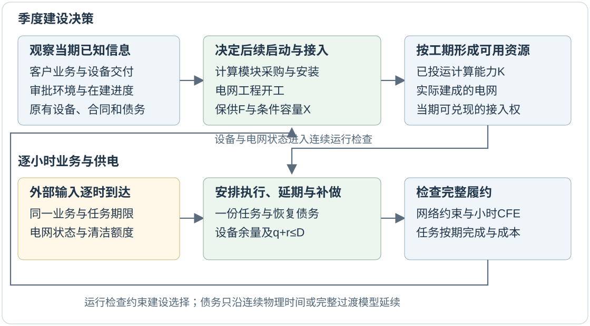

# 智算中心分期投产与电网扩建协同规划

考虑业务达产、任务恢复与小时级清洁电力匹配

2026年10月21日｜研究方案与现有基础

## 1 项目要解决什么问题

本项目研究固定接入点的大型AI智算中心：当客户业务逐步增长、计算设备分批投运、电网扩建又可能延期时，怎样安排设备投产、接入容量和电网建设，使业务能够按期完成，并满足电网运行和清洁电力要求。

这里有三个相互关联的进度。**业务达产**是客户任务量和设备利用率逐步接近设计水平；**数据中心投产**是服务器及配套设施经过采购、安装、调试后形成可用能力；**电网扩建**是线路或主变经过审批、建设后增加供电能力。这三件事的时间可能不同：设备先到而电网未建成，可能导致设备闲置；业务增长快于设备投产，可能导致计算任务无法承接。

允许部分计算任务延期，为协调这些进度提供了另一种选择。例如，在电网紧张时暂缓批量训练，之后补做，可能支持更早开展部分业务。但补做必须同时有设备空闲空间、电网供电能力和符合清洁目标的电量，并赶在任务截止时间前完成。因此，能够减少多少当期负荷，并不能单独决定能提前接入多少业务。

项目把这一关系放进建设决策：**新增设备既承接新业务，也可能为延期任务提供恢复空间；电网扩建既扩大可用供电能力，也改变任务能够恢复的时间。**研究要判断，这些作用是否足以改变设备投产和电网开工时点，以及在什么条件下有必要保留阶段性的计算余量。

本文给出这项建设方向的完整研究方案。现有基础包括分阶段接入模型、连续任务恢复框架和小型机制核查；联合建设模型、投资比较及其正式数值结果属于后续实施内容。

## 2 研究对象与基本概念

| 概念 | 在项目中具体指什么 |
|---|---|
| 业务需求 | 外部到达的计算任务及其期限。相同外部情景下，各方案面对同一批任务。 |
| 已投运计算能力K | 当期已经完成交付、安装和调试，可用于处理任务的设备能力；与最终设计规模分别记录。 |
| 保供容量F | 在声明的电网状态集合内需要保证可供给的合同容量。它是供给权利，实际用电可以低于额度。 |
| 条件容量X | 允许按照规定网络条件暂时削减的接入额度；使用它需要相应业务能够调整并完成。 |
| 业务柔性D | 任务延期和之后补做所使用的双向调节能力，须通过任务、功率和时间约束验证。D与X是不同量。 |
| 恢复债务 | 已经推迟、但仍须按原任务期限完成的工作量。跨日和跨规划阶段持续保留。 |
| 小时级CFE匹配 | 每小时用电的目标份额，与同小时、适用地域内可归属的无碳电量匹配。CFE范围可包含可再生能源之外的无碳来源。 |

接入合同额度F+X、设备能力K和实际用电分别建模。获得接入额度不代表设备已经投运，设备投运也不代表客户业务已经达产。未能取得接入、设备尚未可用与已承接任务延期，将分别统计。

CFE是电量归属核算。例如某小时用电100MWh、目标80%，该小时需要80MWh符合边界的可归属无碳电量。年度电量总额相等不能单独保证每小时匹配；物理电网安全也需要独立检查。

**图1 建设决策与逐时运行的联系。**季度决策决定当期可用的设备和网络；逐时任务安排检验这些资源能否兑现业务与清洁目标，检验结果再约束后续建设方案。

## 3 要回答的三个研究问题

**问题一：恢复能力会怎样改变建设方案？**在相同业务需求与服务目标下，显式考虑任务补做，是否会改变设备模块投运、电网工程开工、F/X配置或业务接入时点？特别关注提前多投装部分设备、等待电网扩建与降低条件接入规模之间的取舍。

**问题二：根据新信息调整计划，在什么条件下有价值？**当业务增长和交付进度逐步揭示时，可调整的建设策略相对于事先确定全部建设计划，能减少多少业务接入缺口、闲置成本或尾部服务损失？这种收益是否在设备和电网工期不匹配时更明显？

**问题三：小时级清洁要求会怎样改变上述取舍？**提高CFE目标后，恢复可用的小时可能减少。研究将比较年度匹配与小时匹配是否导致不同的设备余量、F/X和工程时点，并识别主要瓶颈来自清洁电量总额、到达时序、设备余量还是任务期限。

这些问题允许出现多种结果：柔性可能缓解供电瓶颈，也可能因恢复空间不足而无法支持提前投产；更严格的清洁要求可能改变建设方案，也可能只增加运行成本。差异的方向和出现条件由模型与比较结果确定。

## 4 模型如何作出决策

### 4.1 两种时间尺度

长期层以季度为决策节点，初始最小模型使用四个季度、两至三个候选计算模块和一个候选电网工程。每季观察已发生的客户业务、设备交付和工程状态，再决定是否启动后续设备模块、是否开工电网工程，以及释放多少F和X。计入当期可运营接入的额度，须受已投运设备及当期建成网络的可交付性约束；未完工工程不能支撑提前放行。已经开工的项目受工期和进度约束，已经形成的设备与合同沿路径延续。

短期层以连续小时安排任务、发电与取电。它检查当期调用、恢复过程、任务期限、小时清洁额度和网络约束。已有运行框架采用168小时登记及按需最多24小时后续观察；拟议建设模型先用较短、覆盖全部任务期限的连续片段核验，再扩展时长。物理时间连续的片段须传递债务和运行状态；若省略了中间时段，必须给出完整过渡模型，不能直接拼接末态。独立季度片段则分别登记前史、覆盖最长任务期限的后续观察，并在各片段内闭合或如实保留未决。跨季度只在真实相邻时间上衔接。

### 4.2 设备与电网分别按工期投运

每个计算模块有采购安装成本、能力、基础工期和可解释的交付状态。只有达到完成条件后，其能力才计入K。电网工程同样经历未开工、在建和投运；投运前不提供新增线路或主变能力。未来工期的随机实现不能提前用于决策。

F沿路径不下降，总合同额度F+X也不下降；扩建投运后可以把部分X转为F，因而X本身可以减少。合同校核与实际负荷运行分开：正常状态检查完整F+X，在声明事故状态下检查至少能够支持F。初始网络层采用明确选择的故障集合与DC模型，并说明其范围。

网络调用随实际建成网络和当期运行状态重新计算。扩建可能改变拥塞位置、所需削减量及恢复时可用供电空间，不能对所有建设方案沿用一条固定调用曲线。D能支持多少X，需要通过这些网络条件和任务恢复约束共同检验。

### 4.3 每次延期都要追踪到完成

对当期承接的基准工作w，q表示被推迟的工作功率，r表示补做消耗的功率，二者使用相同功率基准。共享双向调节额度满足：

**q+r≤D。**

同时，q不能超过当期允许延期的业务；r不能超过已投运设备的空闲空间。若同小时常规执行为w-q，在统一计算单位下，恢复空间上限为max(0,K-(w-q))，再结合设备可用率及任务适配约束；不能重复使用q释放的空间。按任务产生时刻分别登记恢复债务，补做效率η决定r能够完成多少工作；任务须在原截止时间前完成，到期后的补做不能抹去已发生的逾期。设备停机、扩建未完工和负荷增长对恢复空间的影响都在同一时间线上体现。

设备能力采用统一的“功率等效计算能力”单位，实际取电另按“已投运设备待机功耗+执行工作功耗及配套耗能”映射。提前投装的设备因此可能增加待机用电和成本，不能被当作免费的恢复资源。最小算例的线性归一化设定与这一后续设备模型分别记录。

### 4.4 清洁额度与共同履约

设Y为每小时外部可归属的清洁电量，α为匹配目标。实际用电包含补做和设备待机功耗，按小时检查α×用电量≤Y；补做也须满足该小时可用的清洁余量。主比较使用同一清洁资源情景和核算边界，Y的形成不能随方案自己的削减动作变化；发生分配时需守恒并避免重复归属。该设备与清洁额度映射属于本方案待实现部分，现有固定运行协议及结果继续按其原定义解释。

当前运行研究还保留一个具名比较合同：电网与CFE分别承诺的削减量相加，在一份任务和恢复资源内履约。它用来研究分离承诺的后果。建设方案将先固定这种服务定义，再核对它是否适用于目标项目；也会把“同一次实际削减可同时满足两项目标”的协调运行设为单独比较，清楚记录不同服务定义。两种定义的结果分别解释。

### 4.5 决策只能使用当时已知的信息

具有相同已观测历史的场景，必须采用相同的设备启动、电网开工、F/X和业务决策。设备或工程开工后，才可以观察其自身实际进度；尚未开工时可观察的审批、供应链环境信号，与项目自身进度分别定义。逐时恢复也只能使用当时可见的业务、清洁额度和网络信息。

这种规则称为非预见性。它防止模型利用尚未发生的延期或未来清洁高峰，提前选择事后看来最有利的建设和调度方案。

## 5 优化目标、比较方案与计算方法

### 5.1 在同一服务要求下比较成本和缺口

模型采用系统规划视角，同时计入计算模块、电网工程、设备待机和运行用电成本，以及未承接或未完成业务的明确损失。电网约束、合同义务和任务完成规则分别列明，主比较对已承接任务保持相同的截止时间与服务标准。高目标压力测试如需允许缺口，将单独标注，不能用罚值掩盖主模型的硬约束。

经济系数有可靠来源后，比较折现总成本及服务损失；资料不足时，报告“投资规模—业务服务”的可行取舍及参数敏感性。尾部风险根据业务损失分布另行评价，不能由合成等权情景推成现实违约概率。规划期末采用一致的终端资产处理，并完整观察期内已承接任务的结局。

### 5.2 核心比较方案

| 方案 | 建设决策如何确定 | 比较用途 |
|---|---|---|
| 预定分期计划 | 在初始时点确定全部设备与电网开工计划，运行时仍按已知信息调度 | 识别建设适应性的价值 |
| 随信息调整的联合计划 | 按季度已观测业务和工程进度调整后续设备、电网与接入决策 | 候选主方案 |
| 分步确定建设计划 | 先确定设备计划，再优化电网与接入，使用同样数据和服务目标 | 识别联合决策的作用 |
| 完美信息计划 | 从初始时点获知整条未来路径 | 提供理想成本界限，标为不可实施 |

每种建设方案均在完整恢复约束下评价。另通过计算消融识别机制：先只限制瞬时功率，再加入设备余量、任务期限和清洁恢复限制；放松模型生成的计划也要回到完整运行模型检查。消融结果用于解释误差来源。

年度与小时CFE比较使用相同清洁资源供给、资产价格和目标比例，仅改变匹配时间规则。若研究运行层分离记账，则保留network-only、CFE-only、joint-correct和joint-B6四方案，并把业务柔性D与建设容量、接入额度分别报告。

### 5.3 先核验小模型，再扩大规模

最小建设模型先用枚举少量设备与工程启动序列的方式核对混合整数模型结果；逐时恢复用独立流网络检验可分任务的按期安排。投资决策按信息节点共享，运行使用相同因果规则，不将每条场景事后单独优化所得结果当作可实施策略。

当小模型的建设时点、服务余额、工期和信息边界均可独立核验后，再接入已有电网与连续业务框架。规模较大时考虑分解或约束生成，并分别报告上下界、间隙和未决状态。正式计算前登记完整计算路径与资源预算。

## 6 数据、实验与判断标准

| 数据或输入 | 用途与来源边界 |
|---|---|
| 电网与逐时运行 | 复用RTS-GMLC公开电网资料及明确的故障集合；候选线路或主变的参数和成本需要单列依据。 |
| 任务与功率 | 复用Alibaba工作负荷和Google功率资料形成的映射基础；期限、可延期份额、设备效率、待机功耗与冷却映射分别注明来源或假设。 |
| 业务与工程路径 | 初始采用完整交叉的快/慢达产、按期/延期机制情景；保留共同早期历史。真实概率、交付成本及项目进度资料需要进一步取得。 |
| 清洁资源 | 逐时可归属电量和地域边界独立定义；来自不同来源的数据配对属于机制假设，不视为同址同时观测。 |

实验围绕四个因素展开：业务增长相对设备和电网工期的快慢、可延期业务比例、恢复期限与效率、小时清洁目标及额度时序。先固定参数组合和比较目标，再执行全部情景，保留无差异、无改善和不可行的情形。

主要输出包括设备模块与电网的开工/投运图、F/X轨迹、设备利用与恢复余量、业务接入缺口、任务逾期、CFE缺口、网络约束结果及成本。达到最终申请容量20%、50%、100%的时间分别记为T20、T50、T100；只有通过声明的连续运行与任务完成检查，才计入相应里程碑。观察期内未达到的保留右删失。

研究判断分三步。第一，恢复约束是否实际改变建设、接入或投资选择；若只改变调度，就据实定位为运行影响。第二，变化能否由设备余量、有效恢复窗口或工期冲突解释，并在合理参数范围内保留；若没有，则不扩张机制主张。第三，冻结训练阶段选定的策略，在独立新路径上评价服务和成本，报告适应方案改善、持平或劣化的情形。

## 7 现有基础与初步证据

### 7.1 已有的模型和流程基础

项目已有分阶段F/X、候选电网工程和非预见性模型规格，以及选定故障集合下的DC计算基准。连续业务框架已经用短小时合成链检查了调用、恢复债务、事故延续与保存后重放。完整168小时登记及最多24小时后续观察的运行验收、生产计算预算和正式容量前沿仍未完成。

### 7.2 现有参数中的瞬时瓶颈

本次独立重建了绑定的原始数据窗口，并复核1,900个参数单元。其中1,856个CFE相关单元可由同一个小时的必要条件排除：清洁额度很低，而允许延期的业务份额不足。它们说明当前合同和参数下的瞬时限制；该证明未建立所选配对的normal/reference运行可达性，也不是1,856次实际运行失败。其余44个只是未被该证人排除，全部network-only单元仍未知。

这一结果提示，业务柔性并非能够任意扩大。后续建设研究要先交代清洁额度、业务期限和可延期比例的依据，使研究条件对应清楚，再讨论投资选择。

### 7.3 恢复时序与设备余量的构造例

下面给出已精确核验的6小时例子。每小时基准业务为0.2，h0因网侧调用延期0.1、h1因CFE调用延期0.1；两项工作分别须在h3、h4完成，效率取1。两个情形的调用序列、清洁额度总额和峰值相同，仅额度到达时间不同。

| 小时 | h0 | h1 | h2 | h3 | h4 | h5 |
|---|---:|---:|---:|---:|---:|---:|
| 共同调用量 | 0.1 | 0.1 | 0 | 0 | 0 | 0 |
| A：可用清洁恢复额度 | 0 | 0 | 0.2 | 0.2 | 0 | 0 |
| B：可用清洁恢复额度 | 0 | 0 | 0 | 0.2 | 0 | 0.2 |

A可以分两小时各补做0.1，最低D=0.1；B的h5已超期，必须在h3补完0.2，最低D=0.2。若两项期限各延长1小时，B的最低D又回到0.1。因此差异来自有效恢复窗口。

附加例把恢复空间写为已投运能力K减去基准业务0.2：K=0.3时，A可以完成，B无法在期限前补完；K=0.4时，B才有足够空间在h3完成全部恢复。这展示了设备投运能力与业务履约之间的一条明确联系。

全部36个时序、期限和效率组合均保留，并以精确子集条件与独立最大流相互核对。这些是归一化构造案例，不能据此估计现实失败概率；例子尚未包含设备待机功耗、建设成本、电网工程或投资优化，也不证明提前投装更经济。它们为后续建设模型提供可复现的机制起点。

## 8 与已有研究的关系及预期贡献

联合规划、分期建设与工作负荷恢复均有直接前人基础。下表列出最相关的模型差异，编号与项目文献库一致；预印本按所核验版本引用。

| 文献 | 已有基础 | 本方案继续检验的区别 |
|---|---|---|
| Vafamehr等，2019［DC16］ | 不确定性下的数据中心模块与数据网络扩展 | 计算模块与物理电网工程的逐步适应，以及有期限的任务恢复 |
| Shao等，2025［DC17］ | 数据中心与电力系统长期联合投资，投资—运行两阶段 | 信息逐步揭示后还能调整后续投资的建设策略 |
| Zhu等，2026［DC19］ | 输电开工、固定工期与跨中心任务迁移联合规划 | 固定接入点内设备分期投产与跨小时恢复的联系 |
| Khanal等，2026［DC15］ | 容量扩展中的柔性补做及可中断事件约束 | 投资序列、阶段性设备恢复空间与小时CFE的共同影响 |
| Butt等，2026［DC22］ | 现场资源、任务期限与最小接入容量 | 设备和电网两侧的阶段性建设及进度适应 |

另外，Fan和Zhao［DC14］已讨论任务队列与可交付调频容量，Ghosh等［DC23］已提出分期工程架构。Zhao等［DC18］、Wang等［DC20］与Guo等［DC21］分别提供建设序列、AI负荷增长和清洁供电规划的相邻基础；后三篇本轮的部分模型判断来自出版方摘要或索引章节，按该证据范围使用。具体阅读位置与访问限制保存在建设专题证据表。

本方案的候选区别落实在同一固定接入点：逐步揭示的信息约束后续设备与电网启动，已投运K决定跨小时任务恢复空间，小时CFE再限制有效恢复窗口。拟形成三项相互支撑的成果：一是检验这条联系是否改变分期投产与扩建决策；二是分清任务恢复与阶段信息各自的作用；三是识别在什么业务、工期和清洁电力条件下应保留恢复余量、调整条件接入或启动电网工程。贡献能否成立，取决于完整模型是否产生可解释、可复核并区别于近邻研究的决策结果；目前属于待验证的贡献设计。

实施上先完成数据与服务定义，再核验最小建设模型，随后接入连续网络与业务运行，最后比较冻结策略在新情景中的表现。现有小模型证据可解释研究机制，正式建设与经济结论需要完成这一证据链。

## 参考文献

［DC14］Fan, Y.; Zhao, J. (2026). Harnessing Flexible Spatial and Temporal Data Center Workloads for Grid Regulation Services. arXiv:2602.01508. https://arxiv.org/html/2602.01508

［DC15］Khanal, S.; Roh, G.; Yao, B.; et al. (2026). Shift or curtail? How much data-center flexibility is worth depends on the host power grid. arXiv:2608.19622v1. https://arxiv.org/html/2608.19622

［DC16］Vafamehr, A.; Khodayar, M. E.; Manshadi, S. D.; Ahmad, I.; Lin, J. (2019). A Framework for Expansion Planning of Data Centers in Electricity and Data Networks Under Uncertainty. IEEE Transactions on Smart Grid, 10(1), 305–316. https://doi.org/10.1109/TSG.2017.2738444

［DC17］Shao, Z.; Yu, N.; Wong, D. (2025). Stochastic Long-Term Joint Decarbonization Planning for Power Systems and Data Centers: A Case Study in PJM. International Journal of Electrical Power & Energy Systems, 173, 111377. https://doi.org/10.1016/j.ijepes.2025.111377

模型核验版本：arXiv:2510.25118v1，https://arxiv.org/html/2510.25118v1

［DC18］Zhao, H.; Yu, C.; Fu, G.; Zhao, Z.; Sun, H.; Su, X. (2026). Source–Load Coordinated Multi-Stage Low-Carbon Planning for Data Center Clusters Considering Construction Sequence. Energies, 19(17), 4153. https://doi.org/10.3390/en19174153

［DC19］Zhu, M.; Kai, Q.; Liu, Y.; Yan, Y.; Zhao, H. (2026). Virtual Transmission Lines from Data Center Workload Migration: Coordinated Multi-Year Transmission Expansion Planning. arXiv:2610.13032v1. https://arxiv.org/html/2610.13032v1

［DC20］Wang, Q.; Huang, T.; Liu, Q.; Na, J. (2026). Power-infrastructure expansion planning for training-oriented AI data centers under large-model scaling uncertainty. Energy and AI, 25, 100840. https://doi.org/10.1016/j.egyai.2026.100840

［DC21］Guo, F.; Soares, J.; Ma, L.; Song, J.; Tian, Z.; Chen, X.; Vale, Z. (2026). Integrated planning of wind–solar–storage–grid systems for private-wire supplied data centers. Applied Energy, 414, 127841. https://doi.org/10.1016/j.apenergy.2026.127841

［DC22］Butt, H. Z.; Fatima, R.; Li, X. (2026). Minimizing Grid Interconnection Capacity Requirements for AI Data Centers: A Developer-Side Planning Framework with Onsite Resources and Workload Flexibility. arXiv:2608.29359v1. https://arxiv.org/abs/2608.29359

［DC23］Ghosh, S.; Mohammed, N.; Sadi, M. A. H. (2026). A Phased Development Framework Enabling Islanded Operation of Sustainable AI Data Centers With Onsite Grid-Following and Grid-Forming Energy Architectures. arXiv:2607.17391v1. https://arxiv.org/html/2607.17391

数据与核验索引：[核心文献库](../../docs/literature/literature_matrix.csv)、[建设专题证据表](../../docs/literature/construction_evidence_20261021.csv)、[现有证据及小模型核查](../../docs/plan/RQ2_创新性核查与研究判断_20261021.md)。
